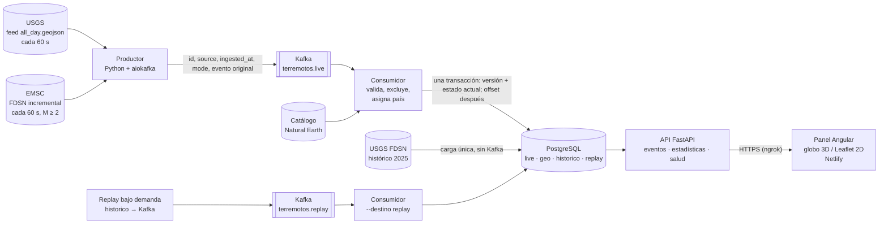
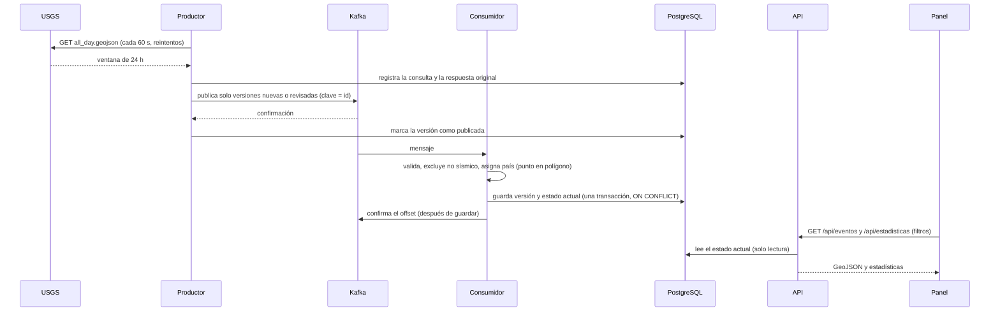

# Observatorio de actividad sísmica

**Un sistema de datos de extremo a extremo para responder una pregunta concreta: ¿dónde se está registrando actividad sísmica y cómo se compara con un periodo histórico equivalente?**
Extrae terremotos de USGS (y, como segunda fuente en vivo, de EMSC), los transporta con Kafka, los valida y los integra con un catálogo geográfico en PostgreSQL, los sirve con una API FastAPI y los analiza en un panel Angular («Mission Control») con globo 3D, mapa 2D, estadísticas y comparación con 2025.

Proyecto académico de **Sistemas de Big Data** (Máster en IA y Big Data). Cinco servicios de Docker Compose en el equipo del autor, túnel ngrok para la API y panel Angular en Netlify.

> **No es una herramienta de predicción ni de evaluación de riesgo sísmico.** Describe lo observado en datos de USGS y EMSC, con sus limitaciones de cobertura y de revisión.

> **Fuentes en vivo (F8)**: además del feed de USGS, el sistema integra de forma aditiva el feed incremental de EMSC (Centro Sismológico Euro-Mediterráneo, CC BY 4.0) para cubrir mejor Europa y el Mediterráneo. Un terremoto informado por ambas fuentes se muestra **una sola vez** (el de USGS); la comparación con 2025 sigue siendo solo de USGS. Se apaga con `EMSC_ACTIVO=false`. Detalle y pruebas: `docs/evidencias/f8/emsc-segunda-fuente.md`.

## Estado del proyecto (a 2026-11-11)

| Elemento | Estado |
|---|---|
| Código y sistema (F0–F7) | Completo. La versión final del panel (F7 «Mission Control») está en el commit `9008772`; en F8 se añadió una función de Netlify de solo lectura (`frontend/netlify/functions/api.mjs`) y, el 2026-11-15, **mejoras visuales y de uso** del panel (paleta grafito, cabecera, pie con la firma de la autora y mejoras del globo; solo presentación, ver [`8.6`](docs/evidencias/f8/8.6-mejoras-interfaz.md)) |
| Memoria técnica | Redactada: [`docs/entrega/memoria.md`](docs/entrega/memoria.md). Aprobada provisionalmente, con las reservas R1–R11 de su [Anexo C](docs/entrega/memoria.md#anexo-c--reservas-y-pendientes-de-esta-memoria) |
| Web publicada (Netlify) | Sirve la versión **F7** (Mission Control) **con las mejoras de interfaz de F8.6** y una función de Netlify: `https://observatorio-sismico.netlify.app` (despliegue `6afa2ccf…` del 2026-11-15; el anterior, `6af4b81f…` del 2026-11-11, queda como respaldo; **sin formulario de clave**, refresco de 60 s). Verificada con la API real por el túnel en un navegador del propio equipo y **comprobada por la persona estudiante en un Google Pixel con datos móviles** (2026-11-11; confirmación sin capturas archivadas) `[ACTUALIZAR EN CIERRE]`. F6 se conserva como respaldo |
| Vídeo explicativo | **Pendiente**: lo grabará el autor con OBS. Duración máxima 5 min, siguiendo el orden de la [rúbrica](#16-cumplimiento-de-la-rúbrica); el guion es material personal y no forma parte del repositorio |
| Entrega y evaluación | Entrega prevista el **19 o 20 de noviembre de 2026** y evaluación prevista el fin de semana del **21–22**; fechas **sin confirmar** |
| Disponibilidad | **No es permanente.** El backend corre en el equipo del autor: se activará durante la ventana de evaluación (ver [§14](#14-seguridad-limitaciones-y-condiciones-de-despliegue)) |

**Cifras históricas frente a dinámicas.** Los resultados históricos (conclusiones de F5, calidad del histórico 2025, mediciones de F6, pruebas de aceptación) se citan **con su fecha de referencia y no se recalculan** porque lleguen nuevos terremotos. Las cifras de EN VIVO cambian cada minuto: aquí solo aparecen con fecha y no deben leerse como permanentes.

## Índice

1. [Presentación y funcionalidades](#1-presentación-y-funcionalidades)
2. [Cómo revisar este repositorio](#2-cómo-revisar-este-repositorio)
3. [Arquitectura y recorrido de los datos](#3-arquitectura-y-recorrido-de-los-datos)
4. [Tecnologías y estructura del repositorio](#4-tecnologías-y-estructura-del-repositorio)
5. [Instalación y configuración segura](#5-instalación-y-configuración-segura)
6. [Docker Compose y servicios](#6-docker-compose-y-servicios)
7. [Kafka, PostgreSQL, FastAPI y contrato de la API](#7-kafka-postgresql-fastapi-y-contrato-de-la-api)
8. [Frontend Angular «Mission Control»](#8-frontend-angular-mission-control)
9. [Modos EN VIVO y REPRODUCCIÓN](#9-modos-en-vivo-y-reproducción)
10. [Calidad, modelo SQL, índices, huecos y retención](#10-calidad-modelo-sql-índices-huecos-y-retención)
11. [Análisis, resultados y conclusiones](#11-análisis-resultados-y-conclusiones)
12. [Pruebas y evidencias verificables](#12-pruebas-y-evidencias-verificables)
13. [Rendimiento, complejidad y costes](#13-rendimiento-complejidad-y-costes)
14. [Seguridad, limitaciones y condiciones de despliegue](#14-seguridad-limitaciones-y-condiciones-de-despliegue)
15. [Cómo usar y demostrar la aplicación](#15-cómo-usar-y-demostrar-la-aplicación)
16. [Cumplimiento de la rúbrica](#16-cumplimiento-de-la-rúbrica)
17. [Documentación y enlaces](#17-documentación-y-enlaces)
18. [Capturas](#18-capturas)
19. [Actualización final antes de la entrega](#19-actualización-final-antes-de-la-entrega)
20. [Operación: parada, recuperación y entorno limpio](#20-operación-parada-recuperación-y-entorno-limpio)

---

## 1. Presentación y funcionalidades

**Objetivo.** Combinar un **histórico** (USGS 2025, magnitud ≥ 4), la **información reciente** (feed `all_day`, últimas 24 h, consultado cada 60 s) y un **catálogo geográfico** (Natural Earth 1:110 M) para mostrar la actividad actual y compararla con una referencia histórica equivalente, controlando duplicados, revisiones y fallos.

**Funcionalidades principales**

| Área | Qué hace |
|---|---|
| Extracción | El productor consulta USGS cada 60 s con reintentos, registra cada consulta, conserva la respuesta original y publica en Kafka solo versiones nuevas o revisadas |
| Segunda fuente (EMSC) | Tarea independiente del productor: consulta incremental cada 60 s (M ≥ 2) por el mismo topic y consumidor. Un terremoto informado por USGS y EMSC se muestra **una sola vez** (el de USGS; regla en [`docs/evidencias/f8/emsc-segunda-fuente.md`](docs/evidencias/f8/emsc-segunda-fuente.md)). Se apaga con `EMSC_ACTIVO=false` |
| Procesamiento | El consumidor valida, excluye lo no sísmico o inválido (cuarentena con motivo), asigna el país **por pertenencia al polígono** y guarda historial de versiones y estado actual de forma idempotente |
| Almacenamiento | PostgreSQL con esquemas separados `live`, `geo`, `historico` y `replay`, claves únicas y `CHECK` que impiden mezclar modos |
| API | FastAPI: `/api/eventos`, `/api/estadisticas`, `/api/salud`; filtros coherentes, paginación y errores explícitos |
| Panel | Tres vistas — **Panel**, **Análisis**, **Eventos** —, globo 3D con alternativa Leaflet 2D, filtros, estadísticas, comparación con 2025 y estado del sistema |
| Reproducción | Envía por Kafka una selección acelerada de 2025 con casos controlados (duplicado, revisión, antigua, magnitud nula, marítimo, coordenadas inválidas), aislada de lo actual y etiquetada **REPRODUCCIÓN** |
| Robustez | Recuperación de huecos de ingesta con el catálogo histórico, reinicios sin duplicar, persistencia en volúmenes y avisos de conexión o desactualización en el panel |

## 2. Cómo revisar este repositorio

| Si quieres… | Mira… |
|---|---|
| Entender el sistema y justificar las decisiones | La [memoria técnica](docs/entrega/memoria.md) (diccionario, procedencia, calidad, modelo, análisis, mediciones, costes, pruebas, reproducción) |
| Ver cómo se cumple cada criterio de la rúbrica | [§16](#16-cumplimiento-de-la-rúbrica) y la [matriz de trazabilidad](docs/entrega/matriz-trazabilidad.md) (con las fuentes literales en [`requisitos-fuente.md`](docs/entrega/requisitos-fuente.md)) |
| Comprobar que lo afirmado está probado | [§12](#12-pruebas-y-evidencias-verificables) y [`docs/evidencias/`](docs/evidencias/) (cada fase tiene su `resultados.md`) |
| Ejecutar el sistema | [§5](#5-instalación-y-configuración-segura) y [§15](#15-cómo-usar-y-demostrar-la-aplicación) |
| Probar la web | [§14](#14-seguridad-limitaciones-y-condiciones-de-despliegue): la versión publicada es F7 y el sistema solo está activo durante la ventana de evaluación |
| Ver qué falta o qué tiene reservas | [§14](#14-seguridad-limitaciones-y-condiciones-de-despliegue), [§19](#19-actualización-final-antes-de-la-entrega) y el [Anexo C de la memoria](docs/entrega/memoria.md#anexo-c--reservas-y-pendientes-de-esta-memoria) |

## 3. Arquitectura y recorrido de los datos



**Recorrido de un evento**



Un reenvío tras una caída no duplica nada: la clave `(event_id, updated_at)` y el `ON CONFLICT DO NOTHING` absorben la repetición, y el estado actual solo avanza con un `updated` mayor. Detalle en la [memoria §1.3](docs/entrega/memoria.md#13-arquitectura-y-flujo-de-datos) y §10.1.

## 4. Tecnologías y estructura del repositorio

| Capa | Tecnología (versión fijada) |
|---|---|
| Productor y consumidor | Python 3.13, `aiokafka` 0.15.0, `psycopg` 3.3.7, `shapely` 2.2.0 |
| Broker | Apache Kafka `apache/kafka:4.3.2` |
| Base de datos | PostgreSQL `postgres:17.11` |
| API | FastAPI 0.162.0, Uvicorn 0.54.0, Pydantic 2.14.2 |
| Panel | Angular 20.3.0 (componentes standalone), Leaflet 1.9.4 con `@bluehalo/ngx-leaflet`, Three.js 0.187.0 (globo 3D), RxJS 7.8.2 |
| Contenedores | Docker Compose v2 |
| Publicación | ngrok (HTTPS para la API) y Netlify (SPA) |

```text
.
├── compose.yaml            # los cinco servicios y los volúmenes pgdata y kafkadata
├── .env.example            # variables (sin credenciales); el .env real no se versiona
├── backend/
│   ├── Dockerfile          # imagen compartida (Python 3.13)
│   ├── requirements*.txt   # dependencias fijadas
│   ├── src/observatorio/   # producer · consumer · api · geo · historico · recuperacion · replay
│   └── tests/              # unit/ (backend) y fixtures/
├── frontend/
│   ├── src/app/            # panel Angular (globo/, graficas/, tabla/, filtros/, comparacion/, …)
│   ├── public/             # config.json, datos/paises.geojson, _redirects
│   ├── config-local/       # config del modo local seguro (start:local)
│   ├── proxy.conf.mjs      # proxy SOLO de desarrollo (añade la clave en el servidor)
│   └── tests/              # pruebas con node --test
├── sql/                    # 001–004 (esquemas), consultas/comparacion.sql, mvp/ (histórico)
├── scripts/                # f4/, f5/, f6/ (pruebas, mediciones, verificaciones) y mvp/ (histórico)
├── specs/                  # especificaciones por fase (SDD) e INDICE.md
├── docs/
│   ├── entrega/            # memoria.md, matriz-trazabilidad.md, requisitos-fuente.md
│   ├── evidencias/         # f3/ f4/ f5/ f6/ (resultados y evidencias de cada fase) y mvp/
│   ├── referencias/        # enunciado, guía, FAQ y contrato del profesor (no se modifican)
│   └── HOJA-DE-RUTA.md
└── data/historico/         # originales de USGS 2025 con SHA256SUMS (se genera; ignorado por Git)
```

`sql/mvp/` y `scripts/mvp/` son material histórico del MVP de la fase F2 (un evento sintético): no se ejecutan ni se mantienen. El MVP se conserva en Git (commit `0a56f65`) y en `docs/evidencias/mvp/`.

**Material de apoyo frente a desarrollo propio.** El profesor entregó el proyecto Angular de apoyo con el mapa, el catálogo `paises.geojson`, cuatro eventos ficticios y la configuración de publicación. **Desarrollado en este proyecto:** productor, consumidor, API, SQL, carga histórica, recuperación de huecos, reproducción, filtros, estadísticas, comparación, tabla, gráficas, estado del sistema y el rediseño de F7 (incluido el globo 3D). El archivo de cuatro eventos ficticios solo prueba el mapa (`mode: "demo"`): no sustituye ningún dato real.

## 5. Instalación y configuración segura

### 5.1 Requisitos
- Docker Desktop (Docker Compose v2) en marcha.
- Node.js 24 y npm (panel y pruebas del frontend).
- Conexión a Internet en el primer arranque (imágenes, dependencias y descarga de USGS).
- Solo para publicar (opcional): cuentas gratuitas de **ngrok** y **Netlify** (ver [§14](#14-seguridad-limitaciones-y-condiciones-de-despliegue)). Para ejecutar el sistema en local no hacen falta.

### 5.2 Arranque desde cero
Los comandos están verificados en un entorno limpio paralelo (F6: `docs/evidencias/f6/6.9-entorno-limpio.txt`, una sola máquina; se repetirán con este README en 8.3).

1. **Crear el archivo de entorno** (el `.env` real no se versiona y la contraseña de ejemplo debe cambiarse):

   ```bash
   cp .env.example .env
   ```

   `INGESTA_PUBLICAR` vale `false` por defecto: instalación nueva = **modo seco** (el productor consulta y registra, pero no publica en Kafka). Para ingerir datos reales, ponerlo a `true` en el `.env` local.

2. **Construir la imagen y levantar PostgreSQL y Kafka** (los cinco servicios completos se levantan en el paso 4, cuando el catálogo ya está cargado: el consumidor no pasa a `healthy` hasta entonces):

   ```bash
   docker compose up --build -d --wait postgres kafka
   ```

3. **Esquemas SQL.** En una instalación nueva PostgreSQL ejecuta los cuatro scripts de `sql/` (`001_esquema_live.sql` a `004_esquema_f6.sql`) al crear el volumen. Si el volumen ya existía, se aplican a mano (idempotentes; no borran nada):

   ```bash
   docker compose exec -T postgres sh -c 'psql -U "$POSTGRES_USER" -d "$POSTGRES_DB" -v ON_ERROR_STOP=1 -f /docker-entrypoint-initdb.d/001_esquema_live.sql -f /docker-entrypoint-initdb.d/002_esquema_f3.sql -f /docker-entrypoint-initdb.d/003_esquema_f4.sql -f /docker-entrypoint-initdb.d/004_esquema_f6.sql'
   ```

   Cargar el **catálogo de países** en la dimensión `geo` (una vez; el consumidor no procesa eventos hasta que el catálogo montado coincida con la base):

   ```bash
   docker compose run --rm --no-deps -v "$PWD/frontend/public/datos/paises.geojson:/datos/paises.geojson:ro" -e CATALOGO_PATH=/datos/paises.geojson producer python -m observatorio.geo.catalogo
   ```

   Cargar el **histórico de 2025** (una vez; ver [§10.4](#104-histórico-de-2025-y-recuperación-de-huecos)).

4. **Levantar los cinco servicios y comprobarlos** (solo la API se publica en el equipo, `127.0.0.1:8000`; Kafka y PostgreSQL quedan internos):

   ```bash
   docker compose up -d --wait
   docker compose ps
   ```

   Con el catálogo y los esquemas ya cargados, `docker compose up --build -d` arranca los cinco servicios a la vez.

5. **Comprobar la API:**

   ```bash
   curl http://127.0.0.1:8000/api/salud
   curl http://127.0.0.1:8000/api/eventos
   ```

6. **Ver el panel** (`frontend/public/config.json` con `mode: "api"`; con `mode: "demo"` se ven solo los cuatro eventos ficticios del Panel):

   ```bash
   cd frontend
   npm ci
   npm start            # http://localhost:4200
   ```

### 5.3 Modo local con acceso automático (solo desarrollo)
Si la API exige clave (`API_CLAVE_ACCESO` en el `.env` privado), `npm run start:local` evita escribirla en el formulario: el servidor de desarrollo de Angular reenvía `/api` a `http://127.0.0.1:8000` y **añade la cabecera de clave en el servidor** (`frontend/proxy.conf.mjs`). La clave no llega al navegador, a `config.json` ni a los bundles.

```bash
cd frontend
npm run start:local      # http://localhost:4200 (solo escucha en 127.0.0.1); parar con Ctrl+C
```

- Solo reenvía `GET`/`HEAD` de `/api/eventos`, `/api/estadisticas` y `/api/salud`; cualquier otra ruta da 404, y las peticiones con rastro de túnel o de otro origen dan 403.
- La API sigue exigiendo la clave: sin ella, `curl http://127.0.0.1:8000/api/salud` devuelve 401.
- `npm start` y `npm run build` (Netlify) no usan el proxy ni `frontend/config-local/config.json`. **Nunca** expongas el puerto 4200 con ngrok: ngrok solo debe publicar la API (8000).

### 5.4 Variables de configuración (`.env.example`)
| Grupo | Variables |
|---|---|
| PostgreSQL y Kafka | `POSTGRES_DB`, `POSTGRES_USER`, `POSTGRES_PASSWORD`, `KAFKA_BOOTSTRAP_SERVERS`, `KAFKA_TOPIC`, `KAFKA_CONSUMER_GROUP` |
| Ingesta (productor) | `USGS_URL`, `USGS_INTERVAL_S`, `USGS_TIMEOUT_S`, `USGS_MAX_REINTENTOS`, `INGESTA_PUBLICAR`, `CATALOGO_PATH`, `HUECO_MARGEN_S`, `RETENCION_RESPUESTAS_DIAS`, `RETENCION_CONSULTAS_DIAS` |
| Segunda fuente (EMSC) | `EMSC_ACTIVO` (por defecto `true` en Compose), `EMSC_URL`, `EMSC_INTERVAL_S`, `EMSC_MAG_MIN`; avanzadas: `EMSC_TIMEOUT_S`, `EMSC_MAX_REINTENTOS`, `EMSC_VENTANA_INICIAL_H`, `EMSC_VENTANA_MAX_DIAS`, `EMSC_MARGEN_S`, `EMSC_LIMITE`. Solo se consulta con `INGESTA_PUBLICAR=true` |
| Histórico | `HISTORICO_ANIO`, `HISTORICO_MAG_MIN`, `HISTORICO_LIMITE`, `HISTORICO_TIMEOUT_S`, `HISTORICO_MAX_REINTENTOS`, `HISTORICO_EXPORT_DIR` |
| API | `API_MAX_EVENTOS`, `API_MAX_VENTANA_HORAS`, `INGESTA_OBSOLETA_S`, `API_STATEMENT_TIMEOUT_S`, `API_MARGEN_PUBLICACION_S`, `API_CORS_ORIGINS`, `API_DOCS`, `API_CLAVE_ACCESO`, `API_PUERTO` |
| Reproducción | `KAFKA_TOPIC_REPLAY`, `KAFKA_CONSUMER_GROUP_REPLAY`, `REPLAY_EVENTOS`, `REPLAY_INTERVALO_S`, `REPLAY_ESPERA_FINAL_S`, `REPLAY_ESPERA_MAX_S` |

**Seguridad de la configuración.** El `.env` real, el authtoken de ngrok y la clave de la API **nunca** se versionan (`.env` y `.env.*` están en `.gitignore`; solo se versiona `.env.example`). `API_CLAVE_ACCESO` se deja **vacía** en `.env.example`: se genera en el `.env` local (≥ 32 caracteres) siguiendo el comentario del propio archivo. `bash scripts/f6/escaneo_secretos.sh` busca secretos en el árbol. Tras cambiar variables de la API: `docker compose up -d --build --no-deps api` recrea solo la API.

## 6. Docker Compose y servicios

| Servicio | Imagen | Función | Puertos | Salud y reinicio |
|---|---|---|---|---|
| `postgres` | `postgres:17.11` | Datos preparados, originales y estado; volumen `pgdata` | ninguno (interno) | `healthcheck`; `restart: unless-stopped` |
| `kafka` | `apache/kafka:4.3.2` | Transporte; volumen `kafkadata`; retención de 24 h y 100 MiB por partición, segmentos de 6 h | ninguno (interno) | `healthcheck`; `restart: unless-stopped` |
| `producer` | `observatorio-backend` | Consulta USGS (y EMSC, en una tarea aparte que nunca detiene la de USGS), registra, publica y detecta huecos (`observatorio.producer.main`) | ninguno | `healthcheck`; depende de `postgres` y `kafka`; `restart: unless-stopped` |
| `consumer` | `observatorio-backend` | Valida, excluye, asigna país y guarda (`observatorio.consumer.main`); monta el catálogo de solo lectura | ninguno | `healthcheck` (espera el catálogo); depende de `postgres` y `kafka`; `restart: unless-stopped` |
| `api` | `observatorio-backend` | FastAPI/Uvicorn en `0.0.0.0:8000` dentro del contenedor | `127.0.0.1:8000` (solo el anfitrión) | `healthcheck` (con clave si está activa); depende de `postgres`; `restart: unless-stopped` |

Los tres servicios Python comparten una imagen (`backend/Dockerfile`, `python:3.13-slim-trixie`) con comandos de arranque distintos. Los servicios se hablan por su nombre dentro de la red `observatorio` (nunca `localhost`). Productor y consumidor siguen trabajando aunque el panel esté cerrado.

## 7. Kafka, PostgreSQL, FastAPI y contrato de la API

### 7.1 Kafka
- **Topics:** `terremotos.live` (`KAFKA_TOPIC`) y `terremotos.replay` (`KAFKA_TOPIC_REPLAY`); grupos `KAFKA_CONSUMER_GROUP` y `consumidor-replay`.
- **Mensaje:** clave = `event.id`; valor JSON con `source` (`usgs-all-day`; `emsc-fdsn` para EMSC, cuyo Feature se adapta al formato de USGS y conserva el original en `emsc_original`), `ingested_at` (ms Unix UTC), `mode` (`live`) y `event` (el Feature original de USGS **sin transformar**). Contrato: [`specs/002-ingesta-real-calidad/contracts/mensaje-kafka.md`](specs/002-ingesta-real-calidad/contracts/mensaje-kafka.md).
- **Garantías:** procesamiento «al menos una vez» con escritura idempotente (sin transacción distribuida); el offset se confirma **después** de guardar. La retención de Kafka solo afecta a los mensajes del broker, no a PostgreSQL ([§10.5](#105-retención)).

### 7.2 PostgreSQL
Cuatro esquemas, **sin claves foráneas entre `live`, `historico` y `replay`**, con `CHECK` de modo y fuente (un dato de `replay` no puede entrar en `live`). `geo` es la dimensión compartida.

| Esquema | Contenido | Script |
|---|---|---|
| `live` | Estado actual, historial de versiones, versiones publicadas, consultas, respuestas originales, cuarentena, estado de ingesta y huecos | [`001_esquema_live.sql`](sql/001_esquema_live.sql), [`002_esquema_f3.sql`](sql/002_esquema_f3.sql), [`003_esquema_f4.sql`](sql/003_esquema_f4.sql) (huecos y columnas geográficas) |
| `geo` | Versiones del catálogo (huella `sha256`) y entidades (`ADM0_A3`) | [`003_esquema_f4.sql`](sql/003_esquema_f4.sql) |
| `historico` | Instantánea de USGS 2025 (consultas, archivos comprimidos, eventos, cuarentena) | [`003_esquema_f4.sql`](sql/003_esquema_f4.sql) |
| `replay` | Ejecuciones, eventos, versiones y cuarentena de cada reproducción | [`004_esquema_f6.sql`](sql/004_esquema_f6.sql) |

El diccionario de datos, los diagramas (conceptual, lógico y claves foráneas) y la justificación de índices están en la [memoria §2](docs/entrega/memoria.md#2-diccionario-de-datos) y [§5](docs/entrega/memoria.md#5-modelo-conceptual-lógico-y-físico).

### 7.3 API (FastAPI)
Solo `GET`/`OPTIONS`. Contrato mínimo del profesor: [`CONTRATO-API.md`](docs/referencias/CONTRATO-API.md); contrato completo del proyecto: [`specs/004-api-dashboard/contracts/api-f5.md`](specs/004-api-dashboard/contracts/api-f5.md).

| Endpoint | Qué devuelve |
|---|---|
| `GET /api/eventos` | FeatureCollection de `live` (últimas 24 h por defecto). Filtros `start` (inclusivo), `end` (exclusivo), `min_mag`, `country_id` (`sin_pais` = «Sin país asignado») y `fuente` (`usgs` | `emsc`; solo en vivo, 422 en reproducción); paginación `limit`/`offset` (máximo 5 000) y `metadata` con `total`, `next_offset`, `truncated`, `period`, `coverage` y `sin_magnitud`. `mode=replay[&run=…]` selecciona una reproducción |
| `GET /api/estadisticas` | Con los mismos filtros: `por_hora` (horas UTC con ceros; se omite con su motivo si supera 744 casillas), `por_pais`, `magnitud`, `profundidad` y `comparacion` con la media diaria de 2025 |
| `GET /api/salud` | `status`, `database`, `last_ingestion`, `generated`, `ingestion_age_s`, `stale` (umbral `INGESTA_OBSOLETA_S`), `gaps_pending` y `live_since` |

Un parámetro inválido da **422** (`{error: "parametro_invalido", detail}`); una base inalcanzable o una consulta demasiado lenta da **503** (`base_de_datos_no_disponible`): nunca se recorta en silencio ni se devuelve una lista vacía como si fuera un resultado. Las magnitudes ausentes se devuelven como `null` (nunca `NaN`) y no cumplen `min_mag`. Cada petición lee en una transacción de solo lectura `REPEATABLE READ`. Solo `api/comparacion.py` lee `historico.evento` (agregados, para comparar con 2025). CORS: orígenes exactos (`API_CORS_ORIGINS`) y cabecera `ngrok-skip-browser-warning`; con `API_CLAVE_ACCESO` activa, `/api/*` exige `X-Observatorio-Clave`; con `API_DOCS=false` se ocultan `/docs`, `/redoc` y `/openapi.json`.

## 8. Frontend Angular «Mission Control»

Panel en [`frontend/src/app/`](frontend/src/app/) (Angular 20, componentes standalone, estado con *signals*, estilos propios y sin recursos externos de tipografía). **Tres vistas** con navegación por hash (`#panel`, `#analisis`, `#eventos`), siempre montadas, de modo que filtros, selección y globo no se pierden al cambiar de vista. Descripción técnica: [`specs/006-mejoras-evolucion/estado-tecnico-f7.md`](specs/006-mejoras-evolucion/estado-tecnico-f7.md).

| Vista | Contenido |
|---|---|
| **Panel** | Escenario inmersivo con **globo 3D** (por defecto) o **mapa Leaflet 2D**; HUD flotante con filtros (periodo UTC, magnitud mínima, país), selector de modo, evento seleccionado, leyenda de profundidad (interactiva en 3D) y notas; KPI y estado del sistema |
| **Análisis** | Gráficas SVG propias (recuento por hora UTC, por país, distribución de magnitud y de profundidad, cada una con su tabla de texto), **comparación con la media diaria de 2025**, metodología y estado del sistema |
| **Eventos** | Tabla consultable de eventos: búsqueda, orden, paginación, densidad, fila completa seleccionable, enlace «Ver en el globo» y **vista previa 3D** al pasar el ratón o enfocar el lugar |

- **Globo 3D** (Three.js, cargado de forma perezosa): marcadores por magnitud (tamaño) y profundidad (color), rotación automática con pausa, selección y transiciones de cámara, tooltip, terminador solar y calidad adaptativa. **Sin WebGL, o si el globo falla o tarda, cae al mapa 2D con un aviso.** La alternativa 2D está implementada y su comprobación funcional se realizó en el cierre de F7 (navegador integrado), pero **falta archivar una evidencia reproducible o una captura verificable**; se hará en el paso 8.3 (la captura C-03 cubre el mapa 2D en funcionamiento y el caso sin WebGL necesita su propia evidencia).
- **Filtros y estadísticas:** mapa, tabla y gráficas salen de **una única lectura** con el mismo periodo resuelto; la tabla es la alternativa textual al mapa y al color. El panel avisa de conexión perdida (conservando la última lectura con su antigüedad), filtros rechazados, datos desactualizados, resultados truncados, huecos y modo demostración.
- **Reservas que el panel muestra siempre:** el feed reciente no cubre M 4,0–4,5 fuera de EE. UU. como el histórico, por lo que una variación a M ≥ 4 no demuestra un cambio real de actividad (use M ≥ 4,5). No es una predicción.
- **Configuración** (`frontend/public/config.json`): `mode` (`api` o `demo`), `apiUrl`, `refreshMs` y `skipNgrokWarning`; la compilación pública añade `pausarSiOculta`. El refresco es de **60 s** en local **y en la versión F7 publicada** (con `pausarSiOculta`): es un requisito explícito del enunciado (§9). La compilación pública de F6 usó 10 min por la cuota gratuita de ngrok (20 000 peticiones al mes, [`procedimiento-ngrok-netlify.md`](docs/evidencias/f6/procedimiento-ngrok-netlify.md)); se descartó para F7. **Medido (2026-11-11, un navegador): 3 peticiones `GET` por ciclo en ngrok con la función de Netlify (6, con 3 `OPTIONS`, con la llamada directa de la versión anterior).** Las proyecciones de cuota son estimaciones y **no se conoce el consumo real de la cuenta de ngrok** (contador sin leer) `[ACTUALIZAR EN CIERRE]`.
- **Accesibilidad:** navegación por teclado con foco visible, objetivos táctiles amplios, contraste medido, etiquetas accesibles y respeto de `prefers-reduced-motion` (auditoría estática del código). Reservas: lector de pantalla real solo con Narrador y Edge en F6, sin dispositivo táctil real con F7 (ver [§14](#14-seguridad-limitaciones-y-condiciones-de-despliegue)).

*(Capturas del panel: C-01 a C-04, C-08 y C-13, pendientes — [§18](#18-capturas).)*

## 9. Modos EN VIVO y REPRODUCCIÓN

La API y el consumidor solo admiten los modos del contrato: `live` y `replay`.

| | EN VIVO (`live`) | REPRODUCCIÓN (`replay`) |
|---|---|---|
| Datos | Feed real de USGS (últimas 24 h) | Selección real de 2025 (leída solo de `historico.evento`) más seis casos controlados |
| Topic / grupo / esquema | `terremotos.live` / `KAFKA_CONSUMER_GROUP` / `live` | `terremotos.replay` / `consumidor-replay` / `replay` |
| Quién procesa | Consumidor permanente | Consumidor efímero con `--destino replay` (reutiliza el mismo código idempotente) |
| Fechas | Reales y actuales | **Las originales (2025)**; el instante de reproducción va aparte (`ingested_at`) |
| En el panel | Sin etiqueta | Etiqueta **REPRODUCCIÓN** y tratamiento violeta en toda la interfaz; la comparación con 2025 «no aplica» |

**Aislamiento.** Topic y grupo propios (el código impide que coincidan con los de vivo), esquema `replay` sin claves foráneas hacia `live` ni `historico`, `CHECK` de modo y fuente en la base y `mode=live|replay` en la API (otro valor → 422). Evidencia: `docs/evidencias/f6/aislamiento.txt` (0 ids de replay en `live`).

**Casos controlados** (solo en `replay`, ids `replay-ctl-…`, derivados de eventos reales): `duplicado`, `revision`, `antigua`, `magnitud_nula`, `maritimo` y `coordenadas_invalidas`. Una ejecución publica 39 mensajes (30 reales + 9 de casos) y produce **35 eventos actuales, 37 versiones y 1 en cuarentena** (`docs/evidencias/f6/6.3-aceptacion.md`).

**Cómo reproducir** (≈ 76 s con `REPLAY_INTERVALO_S=2`, ×31,9; con 0,5 s, ×127,6):

```bash
docker compose run --rm --no-deps producer python -m observatorio.replay.reproducir --solo-plan            # muestra la secuencia; no publica ni registra nada
docker compose run --rm --no-deps consumer python -m observatorio.consumer.main --destino replay &       # consumidor efímero (termina solo tras REPLAY_ESPERA_FINAL_S sin mensajes)
sleep 8; docker compose run --rm --no-deps producer python -m observatorio.replay.reproducir --run r-demo
```

La API sirve esos datos con `GET /api/eventos?mode=replay[&run=r-demo]` y el panel los muestra con el selector **REPRODUCCIÓN**. Para repetir o reanudar: `--reanudar <RUN_ID>`. Guion completo: [`docs/evidencias/f6/reproduccion-historica.md`](docs/evidencias/f6/reproduccion-historica.md); resumen en la [memoria §9](docs/entrega/memoria.md#9-reproducción-histórica). La reproducción es la vía para **demostrar actividad cuando no hay terremotos nuevos**.

*(Capturas: C-09, C-10 y C-11, pendientes — [§18](#18-capturas).)*

## 10. Calidad, modelo SQL, índices, huecos y retención

### 10.1 Calidad de los datos
Reglas explícitas en el consumidor (`backend/src/observatorio/consumer/mensaje.py`):

| Situación | Tratamiento |
|---|---|
| `type` ≠ `earthquake` (`quarry blast`, `explosion`, `ice quake`…) | Cuarentena `excluido` con el motivo; no llega a la API |
| JSON ilegible, `id` ausente, geometría no `Point`, coordenadas fuera de rango, tiempos no válidos, caracteres no almacenables | Cuarentena `invalido` con motivo y el original (`payload`) |
| `mode` o `source` no admitidos | Descartado, con motivo en el registro |
| Magnitud nula; magnitud o profundidad negativas | **Se conservan** (nunca se rellena con 0); «ND» en el panel |
| Punto sin polígono | «Sin país asignado» (nunca el país más cercano) |

**Resultados históricos** (seis dimensiones sobre los 18 302 eventos de 2025, `docs/evidencias/f4/4.6-calidad.txt`, 2026-11-07): completitud 100 % en magnitud, profundidad y lugar; 0 duplicados; 0 fallos de validez; 0 diferencias con el original; exactitud 40/40 frente a la consulta por id a USGS. Para el feed en vivo hay una muestra **pequeña y temprana de F3** (2026-11-06, 198 eventos): [memoria §4.4](docs/entrega/memoria.md#44-resultados--feed-en-vivo-muestra-de-f3-denominador-198-eventos-actuales). Límites: no hay verdad terreno de magnitud ni localización. Ejemplos reales y controlados, antes/después y recuentos por transformación: [memoria §4](docs/entrega/memoria.md#4-calidad-de-los-datos).

### 10.2 Integración geográfica
`frontend/public/datos/paises.geojson` (Natural Earth 1:110 M, WGS84, 177 entidades, `ADM0_A3` único) se monta de **solo lectura** en el consumidor; `geo.catalogo` guarda su huella `sha256`. Regla ([`regla-geografica.md`](docs/evidencias/f4/regla-geografica.md)): un solo polígono → ese país (`interior` o `frontera`); varios → el menor `ADM0_A3` (`varias`); ninguno → «Sin país asignado» (`sin_pais`). `USA` y `SDN` traen geometrías inválidas y se reparan **solo en memoria**. Límites: escala 1:110 M (islas pequeñas ausentes, costas simplificadas); el 78,4 % del histórico queda «sin país». Asignación retroactiva a eventos ya guardados:

```bash
docker compose run --rm --no-deps -v "$PWD/frontend/public/datos/paises.geojson:/datos/paises.geojson:ro" -e CATALOGO_PATH=/datos/paises.geojson producer python -m observatorio.geo.retroactivo
```

### 10.3 Modelo e índices
Esquemas y claves en [`sql/`](sql/); diagramas y justificación en la [memoria §5](docs/entrega/memoria.md#5-modelo-conceptual-lógico-y-físico). Un terremoto tiene versiones `(event_id, updated_at)`; el estado actual solo avanza con un `updated` mayor. **Los índices se justifican midiendo**: el de `event_time` se mantiene aunque con ≈ 200–400 filas el planificador no lo use, y un índice parcial previsto se retiró al medirlo (`docs/evidencias/f3/3.6-indices-y-retencion.txt`, `docs/evidencias/f5/5.7-explain.txt`).

### 10.4 Histórico de 2025 y recuperación de huecos
**Histórico:** terremotos de USGS de 2025 (mundo, M ≥ 4, `earthquake`) en 12 tramos mensuales UTC, en `historico`, aislado de `live` y de la API; se carga directamente en PostgreSQL (sin Kafka), una sola vez; repetir la orden no consulta a USGS. Cada respuesta original se guarda comprimida en `historico.archivo` y se exporta a `data/historico/` (ignorada por Git) con su `sha256` en `SHA256SUMS`:

```bash
docker compose build
mkdir -p data/historico
docker compose run --rm --no-deps -v "$PWD/frontend/public/datos/paises.geojson:/datos/paises.geojson:ro" -v "$PWD/data/historico:/exportacion" -e CATALOGO_PATH=/datos/paises.geojson producer python -m observatorio.historico.cargar
docker compose run --rm --no-deps producer python -m observatorio.historico.cargar --solo-recuento   # solo `count` por mes, sin descargar ni escribir
```

Resultado documentado (2026-11-07): **18 302 eventos**, 24 peticiones (12 `count` + 12 `query`), 12/12 meses = `count` de USGS, 0 duplicados (`docs/evidencias/f4/4.4-carga-real.txt`). Verificación: `scripts/f4/verificar_historico.py` y `scripts/f4/trazabilidad_historico.py`.

**Recuperación de huecos.** El productor anota en `live.hueco` un intervalo cuando pasó más de 24 h − `HUECO_MARGEN_S` (6 h por defecto) desde la última consulta correcta. La recuperación es **a demanda** y usa el canal real (`source = usgs-fdsn-recuperacion`), omitiendo lo ya guardado:

```bash
docker compose run --rm --no-deps producer python -m observatorio.recuperacion.recuperar --listar    # huecos pendientes
docker compose run --rm --no-deps producer python -m observatorio.recuperacion.recuperar --simular   # cuenta lo que publicaría
docker compose run --rm --no-deps producer python -m observatorio.recuperacion.recuperar             # recupera
bash scripts/f4/invariantes.sh despues-de-recuperar                                                  # verificación
```

**Caso real: hueco #475** (el equipo estuvo apagado ≈ 19,6 h; recuperado el 2026-11-10 23:07 UTC): 9 versiones publicadas, 8 guardadas y 1 explosión en cuarentena, con los invariantes cumplidos ([`recuperacion-hueco-475.md`](docs/evidencias/f4/recuperacion-hueco-475.md)). Procedimiento y límites: [`procedimiento-hueco.md`](docs/evidencias/f4/procedimiento-hueco.md) y [memoria §3.5](docs/entrega/memoria.md#35-recuperación-de-huecos-de-ingesta). Limitación: solo se ha recuperado este hueco real, y hay dos interrupciones anteriores sin hueco registrado y sin investigar.

### 10.5 Retención
| Almacén | Política | Estado |
|---|---|---|
| Kafka `terremotos.live` | 24 h y 100 MiB por partición, segmentos de 6 h (solo afecta al broker, no a PostgreSQL) | Verificado (`f3/3.6-indices-y-retencion.txt`) |
| `live.respuesta_original` y `live.consulta_extraccion` | 3 y 30 días (`RETENCION_*_DIAS`) | **Provisional**: sin evidencia de purga efectiva ni de decisión definitiva |
| Versiones, estado actual, cuarentena, histórico y replay | Sin purga | Diseño de [`specs/002-ingesta-real-calidad/data-model.md`](specs/002-ingesta-real-calidad/data-model.md) |

## 11. Análisis, resultados y conclusiones

El panel calcula **en SQL sobre el estado actual** recuentos por hora UTC (las horas sin eventos valen 0), por país (con «Sin país asignado»), distribuciones de magnitud y profundidad (con «sin valor») y la **comparación histórica**: recuento reciente frente a la media diaria de 2025 con los mismos filtros (total / días, **incluyendo los días sin eventos**), también con mediana y variación «no definida» si la media es 0. Las consultas de referencia están en [`sql/consultas/comparacion.sql`](sql/consultas/comparacion.sql).

**Tres conclusiones** (periodo fijo `[2026-11-05T17:00:00Z, 2026-11-07T18:00:00Z)` ≈ 2,04 días, reproducidas el **2026-11-07** con `scripts/f5/conclusiones_57.py`; **no se recalculan** con los datos posteriores). Fuente completa y limitaciones: [`docs/evidencias/f5/conclusiones.md`](docs/evidencias/f5/conclusiones.md) y [memoria §6.2](docs/entrega/memoria.md#62-tres-conclusiones-fundamentadas).

| # | Conclusión | Cifra | Naturaleza |
|---|---|---|---|
| 1 | La mayoría de los terremotos fuertes caen fuera de todo polígono de país | De los de **M ≥ 4,5**: **17 de 22 (77,3 %)** «Sin país asignado» en el periodo reciente; **7 079 de 8 559 (82,7 %)** en 2025 | **Hallazgo real**; los porcentajes son del mismo orden y la diferencia de 5 puntos con 22 eventos **no es concluyente** |
| 2 | El recuento reciente de M ≥ 4,5 es inusualmente bajo frente a 2025 | **22 terremotos en ≈ 2,04 días (10,8/día)** frente a una media diaria de 2025 de **23,45** (mediana 19); solo el 1,0 % de las ventanas de 49 h de 2025 tuvo 22 o menos | **Diferencia observada, NO concluyente**: ≈ 2 días de muestra, réplicas que elevan 2025, lo reciente es preliminar. No demuestra un descenso real |
| 3 | Por debajo de M 4,5 el feed reciente recoge una fracción mucho menor que el histórico | Banda M 4,0–4,5: **53,2 %** de los M ≥ 4 en 2025 frente a **29,0 %** (9 de 31) en el periodo reciente | **Diferencia de cobertura, no de actividad**; muestra mínima y catálogo revisado frente a feed preliminar |

Estas cifras **no son una predicción ni una evaluación de riesgo**. Capturas con los filtros: C-05, C-06 y C-07 (pendientes, [§18](#18-capturas)).

## 12. Pruebas y evidencias verificables

**Fechas y alcance.** Todo lo de esta sección es evidencia **de fases anteriores, con su fecha**; las comprobaciones finales del sistema actual, la versión publicada y SC-010 **están pendientes** (paso 8.3).

### 12.1 Pruebas de aceptación del enunciado (§11)
Ejecución `r-f6-prueba-b` del 2026-11-08 (`docs/evidencias/f6/6.3-aceptacion.md`), sin inyectar nada en `live`:

| Prueba | Resultado observado | Estado |
|---|---|---|
| Recibir un evento nuevo | Aparece una fila actual, visible en la API; rastro completo en `6.3-rastro.txt` | Verificado |
| Reenviar la misma versión | 1 versión y 1 fila actual; 39 mensajes = 37 versiones + 1 cuarentena + 1 reenvío descartado | Verificado |
| Recibir una versión posterior | La actual cambia (4,7 → 4,8) y el total no aumenta | Verificado |
| Recibir después una versión antigua | La actual conserva la más reciente (5,2); la antigua queda solo en el historial | Verificado |
| Magnitud nula | `mag = null`, «ND» en el panel | Verificado |
| Coordenadas inválidas | Cuarentena «coordenadas fuera de rango»; 0 puntos | Verificado |
| Evento marítimo | «Sin país asignado»; permanece en el análisis | Verificado |
| Reiniciar el consumidor | Lag 0 → 7 → 0 en ≈ 10 s sin duplicados (`6.8-consumidor.txt`) | Verificado **con reserva ACE-08**: no se capturó un *kill* en mitad de una transacción; la atomicidad se acredita con pruebas transaccionales |
| Cerrar el túnel | El panel muestra «Sin conexión con el backend» y conserva la última lectura (`6.6-tunel.md`) | Verificado **con reserva ACE-09**: con F6 (2026-11-08) y con **F7 publicada** a través del túnel en el navegador integrado del propio equipo (2026-11-11); la persona estudiante comprobó la web en un Pixel con datos móviles, pero **no se repitió el cierre del túnel desde el móvil** |
| Volver a abrir el túnel | Recuperación automática en ≤ 5 s | Verificado **con reserva ACE-10** (ídem) |
| Reproducción histórica | Procesa por Kafka sin mezclarse con `live`: mapa = tabla = estadísticas = API = 35 | Verificado |

### 12.2 Pruebas automatizadas (con fecha)
| Conjunto | Resultado | Fecha y alcance |
|---|---|---|
| Backend (`backend/tests/unit`, Python 3.13, con Kafka real temporal) | **964** pruebas | Regresión final de F6, 2026-11-09 (`docs/evidencias/f6/6.9-regresion-final.txt`); sin cambios de código del backend en F7. **No re-ejecutadas** al redactar este README |
| Frontend (`frontend/tests`, `node --test`) | **476** pruebas | Cierre de F7. Son en buena parte de lectura de código y lógica pura, no de renderizado. **No re-ejecutadas** al redactar este README |

La re-verificación selectiva de ambos conjuntos, el estado actual de los servicios, el README en un entorno limpio y la observación de más de 24 h (**SC-010**, pendiente de autorización) están previstos en el paso 8.3 `[ACTUALIZAR EN CIERRE]`.

Cómo ejecutarlas. Las pruebas de PostgreSQL corren en transacciones que se revierten (las de comparación, en una base temporal que se elimina): no dejan datos en las tablas definitivas.

```bash
# backend (contenedor temporal de la red de Compose, sin tocar los servicios)
F6_KAFKA=1 scripts/f6/ejecutar.sh "python -m pytest -q"      # también: scripts/f4/pruebas.sh y scripts/f5/ejecutar.sh <comando>

# frontend
cd frontend
node --test tests/*.test.ts
npm run build
```

Aislamiento e invariantes de solo lectura: `bash scripts/f6/aislamiento_final.sh` y `bash scripts/f6/invariantes.sh <etiqueta>` (lag, reconciliación, offsets duplicados, huellas, contenedores y volúmenes).

### 12.3 Mapa de evidencias
| Qué | Dónde |
|---|---|
| Resultados por criterio de éxito y reservas de cada fase | [`f3/resultados.md`](docs/evidencias/f3/resultados.md), [`f4/resultados.md`](docs/evidencias/f4/resultados.md), [`f5/resultados.md`](docs/evidencias/f5/resultados.md), [`f6/resultados.md`](docs/evidencias/f6/resultados.md) |
| Lista final de la Guía (13 puntos) | [`f6/lista-final.md`](docs/evidencias/f6/lista-final.md) (estado de 2026-11-09; la matriz de trazabilidad la actualiza) |
| Idempotencia, versiones, calidad y retención | `f3/3.3-*`, `3.4-*`, `3.5-*`, `3.6-*`, `3.7-*` |
| Geografía, histórico, huecos | `f4/` (`regla-geografica.md`, `4.4-*`, `4.6-*`, `procedimiento-hueco.md`, `recuperacion-hueco-475.md`) |
| API, filtros, estadísticas, conclusiones | `f5/` (`5.1-*`…`5.7-*`, `conclusiones.md`) |
| Replay, aceptación, mediciones, costes, ngrok/Netlify, accesibilidad, estabilidad, entorno limpio | `f6/` (`6.1-*`…`6.9-*`, `reproduccion-historica.md`, `complejidad-costes.md`) |
| Estado del panel F7 | [`specs/006-mejoras-evolucion/estado-tecnico-f7.md`](specs/006-mejoras-evolucion/estado-tecnico-f7.md) y [`comprobaciones-manuales-f7.md`](specs/006-mejoras-evolucion/comprobaciones-manuales-f7.md) |

## 13. Rendimiento, complejidad y costes

Cada cifra lleva su etiqueta: **[MEDIDO]**, **[ESTIMADO]**, **[PROYECTADO]**, **[SUPUESTO]** o **[NO DISPONIBLE]**. Detalle y procedimiento en la [memoria §7](docs/entrega/memoria.md#7-complejidad-mediciones-costes-y-mejoras).

**Complejidad y mediciones [MEDIDO]** (2026-11-08; AMD Ryzen 7 7700X, 31 GB de RAM, Windows 11 con Docker Desktop; datos **sintéticos** en una base temporal fuera del análisis real; una sola máquina):

| Operación | Coste medio / peor caso | 10³ → 10⁴ → 10⁵ filas |
|---|---|---|
| Búsqueda de versiones por `event_id` con índice B-tree | O(log n) / O(log n) | ≈ 0,13 ms (constante) |
| …sin índice | O(n) / O(n) | 0,16 → 0,49 → 4,0 ms |
| …en Python: lista / diccionario | O(n) / O(1) esperado | 0,013 → 0,19 → 10,2 ms / 0,0001 → 0,0003 → 0,0006 ms |
| Integración geográfica (STRtree + `covers`) | O(log p + k) por punto | ≈ 7,5 µs por punto en los tres tamaños |
| Agregación por ventanas de 1 h (SQL) | O(n) / O(n) | 0,6 → 4,9 → 35 ms |

**¿Y con 10⁸ registros? [PROYECTADO]**: un modelo lineal calibrado con 10⁵ filas sintéticas (**no es una medición a esa escala**); por ejemplo, ≈ 132 GB de disco con el JSON original y ≈ 12,5 min de asignación geográfica en un núcleo. El ritmo real de ingesta es ≈ 315 versiones/día [MEDIDO, 2026-11-08]. Mejoras razonadas: separar o comprimir el JSON original, particionar por tiempo, resúmenes por hora, paginación por clave en lugar de `OFFSET` y compresión HTTP.

**Costes (ejemplos hipotéticos, no gastos reales)**: con los supuestos del modelo `scripts/f6/modelo_costes.py` — equipo 900 € **[SUPUESTO]**, 4 años **[SUPUESTO]**, 25 % del equipo **[SUPUESTO]**, 65 W **[SUPUESTO]** (no medido), 0,15 €/kWh **[SUPUESTO]** — el subtotal de recursos materiales sería de 141,77 € al año con el equipo encendido 24 h/día y de 84,83 € con 8 h/día. Desarrollo (120 h **[SUPUESTO]**) y mantenimiento (24 h/año **[SUPUESTO]**) se expresan **solo en horas**: no se monetizan. No se calcula ROI (no hay beneficio medible). Una cuota gratuita de ngrok o Netlify **no equivale a coste cero**: sus cuotas se consultaron el 2026-11-08 y deben revalidarse `[ACTUALIZAR EN CIERRE]`.

## 14. Seguridad, limitaciones y condiciones de despliegue

### 14.1 Seguridad
- **Nada de secretos en el repositorio:** `.env`, authtoken de ngrok y clave de la API quedan fuera de Git; `scripts/f6/escaneo_secretos.sh` (0 avisos en F6; **el historial de Git está pendiente de revisar** en 8.3).
- **Solo se expone la API** (`127.0.0.1:8000`, publicada por ngrok); Kafka y PostgreSQL no se publican. **La API publicada exige la clave** `X-Observatorio-Clave` (401 sin ella), con `API_DOCS=false`, solo `GET` y CORS de orígenes exactos. CORS **no es autenticación**.
- **Netlify es público** (sus ficheros lo son). **Desde el 2026-11-11 (despliegue `6af4b81fa1d0a00d0cb33c59`) el visitante no introduce ninguna clave**: una Netlify Function de solo lectura (tres rutas, solo `GET`, parámetros validados, destino fijo, sin CORS) añade la clave en el servidor desde una variable secreta de Netlify; la clave no aparece en el JavaScript, el HTML ni las respuestas, y FastAPI sigue exigiéndola (401 sin ella). **Compromiso asumido:** los datos de lectura son públicos a través de la función y el límite de uso de Netlify es **por IP**, no un tope global. Verificación, incidencias y límites en [`verificacion-funcion-netlify.md`](docs/evidencias/f8/verificacion-funcion-netlify.md) y [`estrategia-publicacion-f7.md` §8 quater](docs/evidencias/f8/estrategia-publicacion-f7.md) `[ACTUALIZAR EN CIERRE]`.
- El **proxy local de F7** (`start:local`) es solo de desarrollo, con destino fijo y rutas cerradas; no debe exponerse.
- **Credencial del profesor:** **no necesita ninguna clave** para usar la web (función de Netlify, T043); la clave solo existe en el `.env` local y en una variable secreta de Netlify. Si se volviera al despliegue anterior, se entregaría por un canal privado. El repositorio solo documenta el procedimiento, nunca la clave.

### 14.2 Condiciones de despliegue y de la ventana de evaluación
- **Arquitectura obligatoria:** el backend corre en el equipo del autor (Docker Compose), la API sale por un túnel de ngrok y el panel se sirve desde Netlify. **Sin equipo o sin túnel no hay datos**: el panel publicado carga pero lo indica (comprobado en F6). No se promete disponibilidad permanente.
- **Ventana de evaluación:** prevista el fin de semana del **21–22 de noviembre de 2026**, y podría empezar en la entrega (19 o 20); fechas **sin confirmar**. Durante ella el equipo estará encendido y sin suspensión, con Docker, Kafka, PostgreSQL, productor, consumidor y API operativos, el túnel activo y el panel publicado. **Esto no se ha verificado todavía** y no equivale a la observación de más de 24 h (SC-010), que es una prueba independiente `[ACTUALIZAR EN CIERRE]`.
- **Versión publicada:** Netlify sirve **F7 con las mejoras de F8.6** (despliegue `6afa2ccf37d6b9bb717c44f4`, 2026-11-15, commit `2616aec`; respaldos: `6af4b81fa1d0a00d0cb33c59` —F7 anterior, 2026-11-11—, `6af4a52d…` y F6), con función de Netlify y sin formulario de clave, `refreshMs` 60 s con pausa si la pestaña está oculta; respaldo: `6af4a52d…` y F6). La estrategia de publicación está en [`estrategia-publicacion-f7.md`](docs/evidencias/f8/estrategia-publicacion-f7.md) y su verificación en [`verificacion-publicacion-f7.md`](docs/evidencias/f8/verificacion-publicacion-f7.md): funcionan el acceso sin clave, las tres vistas, el globo 3D, el mapa 2D, EN VIVO, REPRODUCCIÓN y el aviso y la recuperación tras cerrar y reabrir el túnel; **incidencias menores** (insignia «Powered by Netlify» inyectada por Netlify, errores 400 de algunas teselas de OpenStreetMap en el mapa 2D, estado transitorio al cambiar a REPRODUCCIÓN) y **pruebas pendientes** (otro navegador distinto de Chrome, el cierre del túnel desde el móvil y los contadores reales de ngrok y de Netlify; el caso sin WebGL se comprobó en una copia local con WebGL desactivado) `[ACTUALIZAR EN CIERRE]`. Netlify y ngrok solo se usan con autorización expresa.

### 14.3 Limitaciones y reservas conocidas

- **EMSC (segunda fuente)**: la no duplicación es una **heurística espacio-temporal** (≤ 90 s y ≤ 100 km; M ≥ 4,5: ≤ 300 s, ≤ 300 km, ΔM ≤ 0,6), no una identidad entre catálogos; un mismo sismo con localizaciones muy distintas entre agencias podría no emparejarse. La comparación con 2025 es **solo de USGS**. EMSC acumula datos solo desde su activación y asigna «sin país» más a menudo (más eventos en el mar). Ver [`docs/evidencias/f8/emsc-segunda-fuente.md`](docs/evidencias/f8/emsc-segunda-fuente.md).| Reserva | Detalle |
|---|---|
| R1 · ACE-08 | Falta la comprobación adicional del reinicio en mitad de una transacción |
| R2 · ACE-09/10 y publicación | Túnel cerrado/reabierto verificado con F6 y con F7 publicada (navegador del propio equipo); Pixel con datos móviles confirmado por la persona estudiante (no se probó el cierre del túnel desde el móvil). Continuidad de la ventana: el PC se suspende tras 1 h inactivo si no se cambian los ajustes (`8.3-continuidad-ventana.md`) |
| R3 · SC-010 | Observación de más de 24 h pendiente (no concedida la autorización) |
| R4 · Pruebas | Frontend **521** pasan (2026-11-15; 494 el 2026-11-11 antes de las mejoras de interfaz); backend **964** (2026-11-09) no repetido (código sin cambios); README en entorno limpio no repetido en F8 (PA-11) |
| R5 · Calidad `live` | **Resuelta en F8.5**: SQL literal en `scripts/f8/calidad_live.sql` y muestra nueva del 2026-11-11 (`docs/evidencias/f8/8.5-calidad-live.txt`); las cifras de la memoria §4.4 siguen siendo las de 2026-11-06 |
| R6 · 197/198 | Dos salidas de F3 difieren en un evento (API): **explicación probable por la ventana móvil de 24 h, con respaldo aritmético, no demostrada** ([memoria §4.4](docs/entrega/memoria.md#44-resultados--feed-en-vivo-muestra-de-f3-denominador-198-eventos-actuales)) |
| R7 · Costes | Datos reales del autor pendientes: todo es supuesto |
| R8 · Cuotas y refresco | Refresco público **60 s** (decisión cerrada, enunciado §9). Medido: 3 peticiones/ciclo en ngrok con la función (6 con la llamada directa). Pendiente: contador real de ngrok; una pestaña visible ininterrumpida agotaría la cuota en ≈ 4,6 días [ESTIMADO] |
| Alternativa 2D | Comprobada funcionalmente en F7; falta archivar evidencia reproducible o captura verificable (8.3) |
| R9 · Mermaid | Los 5 diagramas se analizan y renderizan con Mermaid 11.4.1 en un navegador (2026-11-11); **el render en GitHub no se ha comprobado** |
| R10 · Huecos | Dos interrupciones anteriores sin hueco registrado y sin investigar |
| R11 · Función de Netlify (T042–T043) | **Publicada y verificada en producción en un navegador del propio equipo** (sin formulario de clave; 3 peticiones por ciclo y 0 OPTIONS medidas en ngrok); Pixel con datos móviles confirmado por la persona estudiante. Hace públicos los datos de lectura; el límite por IP (60/min) **no es un tope global** (medido: 63 respuestas y 37 con 429 en una ráfaga de 100 desde una IP); consume invocaciones de Netlify (125 000/mes) y peticiones de ngrok; **no se conoce el consumo real de la cuenta de ngrok** |

Otras: el feed no cubre M 4,0–4,5 fuera de EE. UU. como el histórico; lo reciente es preliminar; escala 1:110 M del catálogo; los eventos que USGS elimine o fusione fuera del feed no se detectan (ampliación fuera del alcance mínimo); mediciones de una sola máquina; lector de pantalla real solo con Narrador y Edge; sin Firefox, Safari/iOS ni dispositivo táctil real con F7; `T063` (`down`/`up`) no se ejecutó por decisión del autor.

## 15. Cómo usar y demostrar la aplicación

**A. En local (sin publicar nada)**
1. Arrancar y comprobar los servicios (el sistema real conserva sus datos entre reinicios):

   ```bash
   docker compose up -d --wait        # no recrea lo que ya corre; si el equipo se apagó, los volúmenes conservan los datos
   docker compose ps                  # api, consumer, kafka, postgres y producer en «healthy»
   bash scripts/f6/invariantes.sh demo  # lag 0, reconciliación 0, 0 duplicados, huellas y volúmenes (solo lectura)
   ```

2. Abrir el panel: `cd frontend && npm run start:local` y entrar en `http://localhost:4200` (con la clave en el `.env`; sin ella, el formulario la pide).
3. Recorrer **Panel** (globo 3D, alternar a mapa 2D, filtros, seleccionar un evento, leyenda) → **Análisis** (gráficas, comparación con 2025, estado) → **Eventos** (buscar, ordenar, vista previa 3D, «Ver en el globo»).
4. Lanzar una **REPRODUCCIÓN** ([§9](#9-modos-en-vivo-y-reproducción)) y cambiar el selector a REPRODUCCIÓN para ver los casos controlados.
5. Probar los avisos: detener el productor o la API y observar el estado del sistema; `docker compose start <servicio>` y comprobar la recuperación.

**B. Con la web publicada (solo durante la ventana de evaluación; la versión publicada es F7)**
1. Arrancar Docker Compose y comprobar los servicios (paso A.1).
2. Comprobar que la base tiene los datos y que la ingesta funciona (`bash scripts/f6/invariantes.sh <etiqueta>`; con `INGESTA_PUBLICAR=true`).
3. Activar ngrok **solo con autorización** y abrir el túnel (`ngrok http --url=<dominio> 127.0.0.1:8000`); el destino lo lee la función de Netlify de su variable privada `API_UPSTREAM_URL`, no del `config.json` del sitio. Procedimiento completo: [`procedimiento-ngrok-netlify.md`](docs/evidencias/f6/procedimiento-ngrok-netlify.md) y [`procedimiento-defensa.md`](docs/evidencias/f6/procedimiento-defensa.md) (los 5 pasos de la Guía 3.2; su nombre conserva la antigua «defensa»).
4. Abrir `https://observatorio-sismico.netlify.app`, comprobar datos (**no hay formulario de clave**; si apareciera, estaría publicado el despliegue anterior), filtros y estado de actualización `[ACTUALIZAR EN CIERRE]`.
5. Preparar una reproducción para mostrar actividad si no hay terremotos nuevos.

**Si el equipo, Docker o el túnel se detienen**, el panel publicado seguirá cargando pero mostrará que no puede actualizar. Tras un reinicio, `docker compose up -d --wait` recupera los servicios; si hubo una parada larga, se recupera el hueco a demanda ([§10.4](#104-histórico-de-2025-y-recuperación-de-huecos)).

## 16. Cumplimiento de la rúbrica

Fuente de los criterios: `ENUNCIADO.md` §13 (niveles 0–4, 5–6, 7–8, 9–10) y la tabla de evidencias de la FAQ 34. Los requisitos literales y la trazabilidad completa están en [`requisitos-fuente.md`](docs/entrega/requisitos-fuente.md) y [`matriz-trazabilidad.md`](docs/entrega/matriz-trazabilidad.md). **No se afirma que un criterio esté cumplido sin el respaldo que se indica**; las reservas están en [§14.3](#143-limitaciones-y-reservas-conocidas).

**Vídeo** (máximo 5 min, mismo orden que esta tabla: Extracción, Calidad, Modelado, Análisis, Reflexión; el vídeo lo grabará el autor con OBS y **todavía no está grabado**): en cada criterio se muestran las evidencias de la columna «Pruebas y evidencias». `[ACTUALIZAR EN CIERRE]`

| Criterio | Qué se ha implementado | Memoria | Pruebas y evidencias | Vídeo | Estado y reservas |
|---|---|---|---|---|---|
| **Extracción** (carga + exploración + análisis de tipos) | Productor del feed cada 60 s con reintentos y registro de consultas; carga histórica 2025 por meses con huellas; catálogo geográfico; tabla de tipos y unidades | [§2](docs/entrega/memoria.md#2-diccionario-de-datos), [§3](docs/entrega/memoria.md#3-procedencia-y-registro-de-consultas) | `f3/3.2-ingesta.txt`, `f3/3.7-ejecucion-continua.txt` (30/30 consultas, separación 60,0 s), `f4/4.4-carga-real.txt` (18 302 eventos, 12/12 meses = `count` de USGS), `f4/4.1-catalogo.txt` | B | **Con reservas**: ejecución verificada; ramas HTTP 429/5xx/timeout solo con pruebas unitarias y un fallo inyectado; distribución completa de latencias no agregada ([memoria §3.1](docs/entrega/memoria.md#31-conjuntos-de-datos)) |
| **Calidad** (4+ dimensiones; completo + acciones) | Reglas explícitas del consumidor, cuarentena con motivo, UTC, nulos conservados; análisis de seis dimensiones sobre el histórico y una muestra del feed | [§4](docs/entrega/memoria.md#4-calidad-de-los-datos) | `f4/4.6-calidad.txt` (OK; exactitud 40/40), `f3/3.5-calidad-datos-reales.txt`, `f3/3.5-activacion.txt`, `f3/3.7-despliegue-correccion.txt` | C | **Con reservas**: texto literal de las consultas de `live` sin archivar y muestra de F3 pequeña (R5) |
| **Modelado** (modelo optimizado) | Esquemas `live`/`geo`/`historico`/`replay`; versión + estado actual con upsert idempotente; integración punto-en-polígono; índices medidos | [§5](docs/entrega/memoria.md#5-modelo-conceptual-lógico-y-físico) | `sql/001_esquema_live.sql`, `002_esquema_f3.sql`, `003_esquema_f4.sql`, `004_esquema_f6.sql`; `f3/3.3-versiones.txt`, `3.4-idempotencia.txt`; `f4/regla-geografica.md`, `4.3-bateria.txt`; `f5/5.7-explain.txt` | D | **Con reservas**: diagramas derivados del SQL y renderizado de Mermaid sin comprobar (R9); ACE-08 con reserva (R1) |
| **Análisis** (3+ análisis → insights) | Ventanas horarias UTC, países, distribuciones, comparación equivalente con 2025 y tres conclusiones | [§6](docs/entrega/memoria.md#6-análisis-y-conclusiones) | `f5/conclusiones.md`, `f5/5.2-estadisticas-real.txt`, `f5/5.3-comparacion-real.txt`, `f4/4.6-comparaciones.txt` | E, F | **Con reservas**: conclusiones verificadas con la API (periodo fijo, no concluyentes donde se indica); capturas con filtros C-05…C-07 pendientes |
| **Reflexión** (excelente + propuestas) | Complejidad O(·), mediciones con tres tamaños, comparaciones sin/con índice, costes y mejoras | [§7](docs/entrega/memoria.md#7-complejidad-mediciones-costes-y-mejoras), [§10](docs/entrega/memoria.md#10-decisiones-técnicas-limitaciones-y-trabajo-pendiente) | `f6/6.4-mediciones.txt`, `f6/6.5-comparaciones.txt`, `f6/complejidad-costes.md` | F | **Con reservas**: una sola máquina; 10⁸ filas **proyectado**; costes todo **supuesto** (R7) |

**Lista final de comprobación de la Guía (13 puntos)** — estado según la [matriz](docs/entrega/matriz-trazabilidad.md) (sección B):

| # | Punto | Estado |
|---|---|---|
| 1 | El profesor puede acceder al repositorio | **Pendiente** (usuario y permisos por verificar) |
| 2 | El README permite arrancar desde un entorno limpio | Con reservas: verificado con el README de F6; este README se re-verificará (8.3) |
| 3 | Los cinco servicios están en Docker Compose | Verificado (F6) |
| 4 | Dependencias, Dockerfile, SQL y `.env.example` sin credenciales | Verificado (F6); revisión de secretos pendiente |
| 5 | Campos, unidades, fuentes, filtros y consultas documentados | Documentado en la [memoria §2–§3](docs/entrega/memoria.md#2-diccionario-de-datos) (redactado el 2026-11-11) |
| 6 | Apartado de calidad con consultas, resultados y decisiones | Con reservas (R5) |
| 7 | Modelo conceptual, lógico y físico | Documentado en la [memoria §5](docs/entrega/memoria.md#5-modelo-conceptual-lógico-y-físico) (diagramas por comprobar, R9) |
| 8 | ≥ 3 conclusiones con filtros identificables | Verificadas; capturas pendientes |
| 9 | Mediciones con tres tamaños, complejidad, costes y mejoras | Con reservas (ver arriba) |
| 10 | Pruebas de aceptación ejecutadas con evidencias | Verificado (con las reservas R1 y R2) |
| 11 | Reproducción histórica sin mezclar datos | Verificado |
| 12 | La URL de Netlify funciona y se sabe activar el backend y el túnel | Con reservas: F7 publicada y verificada en un navegador del propio equipo y en un Pixel (confirmado por la persona estudiante); falta la comprobación real de la continuidad |
| 13 | Explicar el flujo y una decisión técnica propia | **Pendiente**: irá en el vídeo (escena G) |

## 17. Documentación y enlaces

| Documento | Contenido |
|---|---|
| [`docs/entrega/memoria.md`](docs/entrega/memoria.md) | Memoria técnica independiente (Guía 2.1–2.9) |
| [`docs/entrega/matriz-trazabilidad.md`](docs/entrega/matriz-trazabilidad.md) | Rúbrica, lista final y pruebas de aceptación → implementación → evidencias → memoria → README → vídeo |
| [`checklist-grabacion.md`](docs/entrega/checklist-grabacion.md) y [`capturas-y-evidencias.md`](docs/entrega/capturas-y-evidencias.md) | Checklist de OBS y lista de capturas y evidencias (estáticas y dinámicas); **el vídeo no está grabado** |
| [`docs/entrega/requisitos-fuente.md`](docs/entrega/requisitos-fuente.md) | Requisitos del profesor con su fuente literal, formato de evaluación y aclaraciones |
| [`docs/HOJA-DE-RUTA.md`](docs/HOJA-DE-RUTA.md) y [`specs/`](specs/) | Fases F0–F8, especificaciones SDD por fase ([`specs/INDICE.md`](specs/INDICE.md)) |
| [`docs/evidencias/`](docs/evidencias/) | Resultados y evidencias de cada fase (F3–F6) |
| [`docs/referencias/`](docs/referencias/) | Enunciado, guía, FAQ, contrato, fuentes y validación del profesor (no se modifican) |
| [`docs/referencias/FUENTES-Y-LICENCIAS.md`](docs/referencias/FUENTES-Y-LICENCIAS.md) | Procedencia y licencias: Natural Earth (dominio público), Leaflet (BSD-2), ngx-leaflet y Angular (MIT), teselas de OpenStreetMap (atribución obligatoria) |

## 18. Capturas

Lista de las capturas previstas del panel final (F7); la **lista ampliada** (C-03b, C-12b, C-15 a C-17 y evidencias que no son imágenes) está en [`docs/entrega/capturas-y-evidencias.md`](docs/entrega/capturas-y-evidencias.md). **Ninguna se ha tomado todavía**; las imágenes se enlazarán aquí cuando existan, sin datos sensibles ni claves. Clase: **[E]** estable (REPRODUCCIÓN o periodo fijo) · **[D]** dinámica (EN VIVO o web publicada).

| Id | Qué mostrar | Clase | Estado |
|---|---|---|---|
| C-01 | Panel con globo 3D, EN VIVO | [D] | Pendiente |
| C-02 | Panel con un evento seleccionado (detalle y leyenda) | [D] | Pendiente |
| C-03 | Alternativa Leaflet 2D con leyenda | [D] | Pendiente |
| C-04 | Vista Análisis completa | [D] | Pendiente |
| C-05 | Filtros de la conclusión 1 (`min_mag = 4,5`, 5–7 nov 2026) | [E] | Pendiente |
| C-06 | Filtros de la conclusión 2 (comparación a M ≥ 4,5) | [E] | Pendiente |
| C-07 | Filtros de la conclusión 3 (M ≥ 4 y M ≥ 4,5) | [E] | Pendiente |
| C-08 | Vista Eventos: tabla, selección y vista previa 3D | [D] | Pendiente |
| C-09 | REPRODUCCIÓN en el Panel | [E] | Pendiente |
| C-10 | REPRODUCCIÓN en Análisis y en Eventos | [E] | Pendiente |
| C-11 | Evento con magnitud «ND» (caso controlado) | [E] | Pendiente |
| C-12 | Aviso «Sin conexión con la API» con el túnel cerrado (comprobado en T036/T043 **sin captura**) | [D] | Pendiente (túnel real) |
| C-13 | Panel y Análisis en móvil | [D] | Pendiente (dispositivo real) |
| C-14 | La web publicada con F7 desde otro dispositivo | [D] | Pendiente (tras publicar F7) |

## 19. Actualización final antes de la entrega

Cerca del 19–20 de noviembre solo queda refrescar lo dinámico (tarea T040 de [`specs/007-documentacion-entrega-video/tasks.md`](specs/007-documentacion-entrega-video/tasks.md)); lo marcado con `[ACTUALIZAR EN CIERRE]` en este README es:

- [ ] **Estado del proyecto:** versión publicada, URL definitiva y fecha de la última revisión.
- [ ] **§8:** refresco público fijado en **60 s** (decisión cerrada); pendientes las capturas C-01…C-04, C-08 y C-13 y anotar el contador real de ngrok.
- [ ] **§12.2 y §14:** resultado de la re-verificación de pruebas, estado de los servicios, SC-010 (si se autoriza), publicación de F7 y ventana de evaluación, con sus fechas.
- [ ] **§13:** cuotas vigentes de ngrok y Netlify y peticiones reales del frontend F7.
- [ ] **§15:** URL y procedimiento definitivos de acceso del profesor.
- [ ] **§16:** bloques del vídeo definitivos y, si procede, estado final de cada criterio.
- [ ] **§18:** enlazar las capturas realizadas; comprobar el renderizado de Mermaid y los enlaces.

## 20. Operación: parada, recuperación y entorno limpio

**Persistencia y parada.** Los volúmenes `pgdata` (PostgreSQL) y `kafkadata` (mensajes y offsets) sobreviven a `stop`, a `down` sin `-v` y a un reinicio del equipo; los contenedores tienen `restart: unless-stopped`. **Nunca** uses `down -v`, `docker volume rm` ni `docker system prune --volumes`: borran los datos.

```bash
docker compose stop      # conserva contenedores y datos
docker compose down      # elimina contenedores y red; conserva los volúmenes. NO añadas -v
```

Si un servicio cae: `docker compose start <servicio>` (el consumidor drena el lag al volver y no duplica nada). Ensayos reales de parada y arranque y estabilidad de 60 min: `docs/evidencias/f6/6.8-*`. Contraseña de PostgreSQL: [`procedimiento-cambio-password-postgres.md`](docs/evidencias/f6/procedimiento-cambio-password-postgres.md).

**Entorno limpio paralelo** (para comprobar que el README basta desde cero **sin tocar el sistema real**). Se usa otro proyecto de Compose con su propia red, imagen y volúmenes, con un archivo de entorno propio (contraseña aparte, `API_PUERTO=8010`, `BACKEND_IMAGE=observatorio-backend-limpio`, `INGESTA_PUBLICAR=false`):

```bash
docker compose -p observatorio_limpio --env-file ENTORNO_LIMPIO.env up --build -d --wait postgres kafka
```

Los pasos 3 y 4 de la [§5.2](#52-arranque-desde-cero) se ejecutan igual anteponiendo `-p observatorio_limpio --env-file ENTORNO_LIMPIO.env` (y con `-v` a otra carpeta de exportación en el histórico). Resultado medido en F6: `docs/evidencias/f6/6.9-entorno-limpio.txt`. Bajarlo sin `-v` conserva sus volúmenes; eliminarlos requiere autorización expresa.

---

*Proyecto académico. Los datos sísmicos proceden de USGS y de EMSC (Centro Sismológico Euro-Mediterráneo, CC BY 4.0, https://www.seismicportal.eu) y el catálogo geográfico de Natural Earth (ver `docs/referencias/FUENTES-Y-LICENCIAS.md`). No es una herramienta de predicción ni de evaluación de riesgo.*
