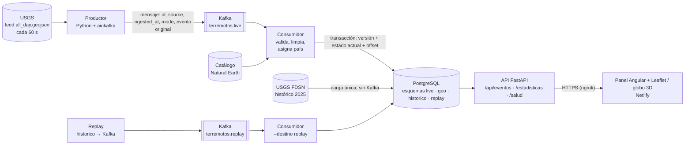
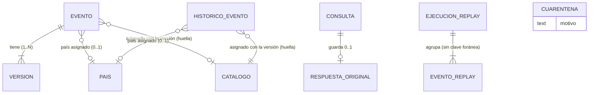
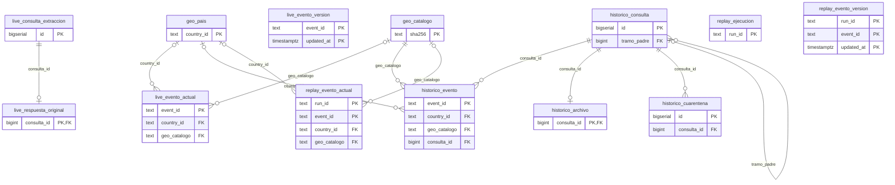

# Observatorio de actividad sísmica — Memoria técnica

**Proyecto académico de Sistemas de Big Data (Máster en IA y Big Data) · RA1**
**Versión del sistema descrita**: commit `9008772` (`[F7]`, rediseño Mission Control) sobre la base de F3–F6, **más las mejoras visuales y de uso del 2026-11-15** (`docs/evidencias/f8/8.6-mejoras-interfaz.md`: paleta grafito, cabecera, pie, mejoras del globo; sin cambios de datos ni de backend) · **Redacción**: 2026-11-11 · **Estado**: **técnicamente corregida y prácticamente cerrada** (F8.2, primera parte; revisión del 2026-11-11), pendiente de tu aprobación documental. Solo quedan las **reservas** (Anexo C), las **capturas** (Anexo D) y lo que depende de la fecha de entrega (Anexo E).

Esta memoria es el entregable técnico **independiente** (`docs/entrega/memoria.md`). Sigue el índice de la Guía de entregables (apartados 2.1–2.9) y enlaza las evidencias del repositorio en lugar de copiarlas. El README (que se redactará después) es la puerta de entrada y enlaza aquí para el detalle.

## Cómo leer esta memoria

**Etiquetas de procedencia de las cifras** (nunca se mezclan):

| Etiqueta | Significado |
|---|---|
| **[MEDIDO]** | Medición real de este proyecto, con evidencia guardada (equipo, fecha y procedimiento indicados). |
| **[ESTIMADO]** | Estimación justificada a partir de datos o evidencias existentes; no es una medición. |
| **[PROYECTADO]** | Resultado de un modelo o extrapolación teórica, no observado a esa escala. |
| **[NO DISPONIBLE]** | Dato que no existe o no se ha obtenido; se indica como tal y no se sustituye por un valor inventado. |
| **[SUPUESTO]** | Valor hipotético de ejemplo (solo en costes), identificado como tal. |

**Estado de las pruebas.** Las cifras de pruebas automatizadas (**964** del backend al cierre de F6 y **476** del frontend al cierre de F7) son **evidencias de fases anteriores**: no se han vuelto a ejecutar al redactar esta memoria. Su re-verificación selectiva corresponde al paso 8.3. Lo mismo vale para el estado actual de los servicios, la publicación en Netlify y la observación de más de 24 h (SC-010), que están **pendientes** y no se dan por comprobados.

**Fechas de referencia y datos dinámicos.** Los datos de USGS siguen cambiando hasta la entrega (previstamente el 19 o 20 de noviembre de 2026, sin confirmar). Por eso: (1) toda cifra de EN VIVO o de la ingesta lleva su **fecha de referencia** y no debe leerse como permanente; (2) los **resultados históricos** (conclusiones de F5, calidad del histórico 2025, mediciones de F6) se conservan con la fecha en que se obtuvieron y **no se recalculan** porque lleguen nuevos terremotos; (3) la marca **`[ACTUALIZAR EN CIERRE]`** señala solo lo que hay que refrescar antes de la entrega, y el **Anexo E** es la checklist de esa actualización.

**Rutas de evidencia.** `f3/…`, `f4/…`, `f5/…`, `f6/…` son carpetas de [`docs/evidencias/`](../evidencias/). `sql/` contiene los esquemas. Los documentos del profesor están en [`docs/referencias/`](../referencias/) y no se han modificado.

## Índice
1. [Objetivo y funcionamiento general](#1-objetivo-y-funcionamiento-general) (Guía 2.1)
2. [Diccionario de datos](#2-diccionario-de-datos) (2.2)
3. [Procedencia, consultas, retención y recuperación de huecos](#3-procedencia-y-registro-de-consultas) (2.3)
4. [Calidad de los datos](#4-calidad-de-los-datos) (2.4)
5. [Modelo conceptual, lógico y físico](#5-modelo-conceptual-lógico-y-físico) (2.5)
6. [Análisis y conclusiones](#6-análisis-y-conclusiones) (2.6)
7. [Complejidad, mediciones, costes y mejoras](#7-complejidad-mediciones-costes-y-mejoras) (2.7)
8. [Evidencias de las pruebas de aceptación](#8-evidencias-de-las-pruebas-de-aceptación) (2.8)
9. [Reproducción histórica](#9-reproducción-histórica) (2.9)
10. [Decisiones técnicas, limitaciones y trabajo pendiente](#10-decisiones-técnicas-limitaciones-y-trabajo-pendiente)
- [Anexo A — Mapa de evidencias reutilizadas](#anexo-a--mapa-de-evidencias-reutilizadas)
- [Anexo B — Cobertura frente al enunciado y la Guía](#anexo-b--cobertura-frente-al-enunciado-y-la-guía)
- [Anexo C — Reservas y pendientes](#anexo-c--reservas-y-pendientes-de-esta-memoria)
- [Anexo D — Capturas pendientes](#anexo-d--capturas-pendientes-lista-no-se-ha-tomado-ninguna)
- [Anexo E — Checklist de actualización final](#anexo-e--checklist-de-actualización-final-de-la-memoria-cerca-del-1920-de-noviembre)

---

## 1. Objetivo y funcionamiento general

### 1.1 La pregunta
El observatorio responde a: **¿dónde se está registrando actividad sísmica y cómo se compara con un periodo histórico equivalente?** (`ENUNCIADO.md` §1). Combina tres fuentes: el feed reciente de USGS (últimas 24 h), un histórico de USGS y un catálogo geográfico de Natural Earth, y las integra en PostgreSQL para analizarlas en un panel. No se presenta como predicción de terremotos ni como evaluación de riesgo.

### 1.2 Decisiones de alcance
| Aspecto | Decisión | Fuente |
|---|---|---|
| Histórico | Año **2025**, ámbito **mundial**, magnitud **≥ 4**, tipo `earthquake`, en 12 tramos mensuales UTC (propuesta de partida del enunciado, §4.2) | `f4/resultados.md` |
| Reciente | Feed `all_day.geojson`, consultado cada **60 s** (`USGS_INTERVAL_S`) | `backend/src/observatorio/config.py` |
| Geografía | Natural Earth Admin 0, escala 1:110 M, 177 entidades, identificadas por `ADM0_A3`; asignación por **punto dentro de polígono** | `f4/regla-geografica.md` |
| Filtros del panel | Fecha (`start` inclusive, `end` exclusivo), magnitud mínima y país/región; los mismos para mapa, tabla y estadísticas | `CONTRATO-API.md` |
| Modos | `live` (datos reales) y `replay` (reproducción acelerada aislada); el histórico se consulta solo para la comparación | `README.md`; `specs/005-…/data-model.md` |

### 1.3 Arquitectura y flujo de datos

Los cinco servicios obligatorios corren en Docker Compose en el equipo del alumno (`compose.yaml`: `postgres`, `kafka`, `producer`, `consumer`, `api`, con los volúmenes `pgdata` y `kafkadata` y la red `observatorio`). Solo la API se publica en el anfitrión (`127.0.0.1`); ngrok la expone por HTTPS y el frontend Angular se publica en Netlify.


*Figura 1. Flujo de datos. El flujo de reproducción reutiliza el procesamiento del consumidor con otro topic, grupo y esquema (§9).*

**Recorrido de un evento** (base de la explicación del flujo): el productor consulta USGS, compara `id` y `updated` con `live.version_publicada` y publica solo novedades y revisiones, con el `id` como clave de Kafka; espera la confirmación de Kafka antes de anotar la versión como publicada. El consumidor valida el mensaje, descarta lo que no es `live` o no es un terremoto (cuarentena con motivo), asigna el país por punto-en-polígono y, **en una sola transacción**, guarda la versión en `live.evento_version` (clave `(event_id, updated_at)`) y actualiza `live.evento_actual` solo si la versión es más reciente; el offset se confirma **después** de guardar. La API lee solo `live.evento_actual` y `live.estado_ingesta` (y, para la comparación, agrega `historico`). **Intervalo de actualización del panel (decisión definitiva del 2026-11-11: 60 s).** El panel consulta la API con el `refreshMs` de su `config.json`: **60 s** en la configuración del repositorio, en el modo local (`frontend/config-local/config.json`) **y en la versión F7 publicada en Netlify** (despliegue `6af4b81fa1d0a00d0cb33c59` con función de Netlify, `refreshMs: 60000` más pausa si la pestaña está oculta). Se mantiene 60 s por ser un **requisito explícito del enunciado** (§9: «el mapa consultará la API cada 60 segundos»; FAQ 21: «aproximadamente cada 60 segundos»), aunque la cuota gratuita de ngrok (20 000 peticiones HTTP al mes) pueda condicionarlo. La compilación pública de F6 usó 10 min (`refreshMs: 600000`) para limitar esas peticiones: fue una decisión propia, no un requisito, y se descartó para F7. **[MEDIDO el 2026-11-11, navegador integrado Chrome 152, `f8/verificacion-publicacion-f7.md`]** con la llamada directa del navegador al túnel (T036, despliegue anterior) cada ciclo hacía **6 peticiones (3 GET + 3 OPTIONS)**; con la **función de Netlify publicada** (T043) el túnel recibe **3 `GET` por ciclo y 0 `OPTIONS`** (4 ciclos consecutivos cada 62–63 s; `f8/verificacion-funcion-netlify.md`). Las proyecciones de cuota son **[ESTIMADO]** (§7.4). **No se ha leído el contador real de la cuenta de ngrok.**

### 1.4 El panel (versión final, F7)
El frontend (Angular 20, standalone, sin dependencias nuevas de datos) tiene **tres vistas** con navegación por hash, siempre montadas: **Panel** (globo 3D por defecto con alternativa Leaflet 2D, filtros, selección de evento, leyenda de profundidad, KPI y estado), **Análisis** (gráficas SVG propias: horas UTC, países, magnitud, profundidad; comparación con 2025; metodología y estado del sistema) y **Eventos** (tabla con búsqueda, orden, paginación, densidad, selección y vista previa 3D). El modo **REPRODUCCIÓN** se identifica con una etiqueta y un tratamiento violeta en toda la interfaz. Descripción técnica: `specs/006-mejoras-evolucion/estado-tecnico-f7.md`. *(Capturas C-01 a C-04 y C-08 y C-13: pendientes, Anexo D. `[ACTUALIZAR EN CIERRE]`)*

### 1.5 Material reutilizado y desarrollado
Según `ENUNCIADO.md` §3 se entregaron: el proyecto Angular de apoyo con el mapa, el catálogo `paises.geojson`, cuatro eventos ficticios y la configuración de publicación. **Desarrollado en este proyecto**: productor, consumidor, API, esquemas SQL, carga histórica, recuperación de huecos, reproducción, filtros, estadísticas, comparación, tabla, gráficas, estado del sistema y el rediseño de F7 (incluido el globo 3D). El archivo de cuatro eventos ficticios (`mode: "demo"`) solo prueba el mapa; no sustituye ningún dato real.

---

## 2. Diccionario de datos

Todos los tiempos se guardan en **UTC** (`timestamptz`); USGS entrega milisegundos Unix, que el sistema convierte conservando el valor original en `raw`. Se separan tres tiempos: **ocurrencia** (`event_time`), **actualización de USGS** (`updated_at`) y **procesamiento** (`ingested_at`, `stored_at`).

### 2.1 Campos del feed de USGS (origen) y tipos/unidades
| Campo (GeoJSON) | Significado | Tipo / unidad en origen | Ausencias |
|---|---|---|---|
| `id` | Identificador del evento | Texto | Obligatorio (sin él: cuarentena `invalido`) |
| `properties.time` | Momento de ocurrencia | Entero, ms Unix UTC | Obligatorio |
| `properties.updated` | Última actualización en USGS (versión) | Entero, ms Unix UTC | Necesario para el control de versiones |
| `properties.mag` | Magnitud | Número (puede ser negativo o nulo) | Se admite nulo; no se sustituye por 0 |
| `properties.magType` | Tipo de magnitud (`ml`, `md`, `mb`, `mww`…) | Texto | Se conserva; no se mezclan escalas sin avisar |
| `properties.type` | Tipo de evento | Texto (`earthquake`, `quarry blast`, `explosion`, `ice quake`…) | Obligatorio; ≠ `earthquake` → cuarentena `excluido` |
| `properties.place` | Descripción textual del lugar | Texto | Se admite nulo; **no** se usa para asignar país |
| `geometry.coordinates` | `[longitud, latitud, profundidad]` | Grados WGS84, grados, **km** | Tres valores obligatorios; la profundidad puede ser negativa |
| Opcionales (p. ej. `felt`, `net`) | Informes de percepción, red | Variable | Se conservan en `raw`; `felt` está presente solo en una minoría (6,6 % en la muestra live de F3; 10,5 % en el histórico) |

### 2.2 Modelo de datos (`live`, `historico`, `replay`) — campos principales
Descripción de los campos principales. **No todas las tablas tienen todas las columnas**: la matriz que sigue a esta tabla indica qué columnas tiene cada una de `live.evento_actual`, `live.evento_version`, `historico.evento` y `replay.evento_actual/evento_version` (definición en `sql/001_esquema_live.sql`, `002_esquema_f3.sql`, `003_esquema_f4.sql` y `004_esquema_f6.sql`):

| Campo | Significado | Tipo / unidad | Tratamiento de ausencias |
|---|---|---|---|
| `event_id` | Identificador del terremoto | `text` | Obligatorio (`CHECK <> ''`) |
| `event_time` | Ocurrencia | `timestamptz` UTC | Obligatorio |
| `updated_at` | Versión (actualización en USGS) | `timestamptz` UTC | Obligatorio; parte de la clave de la versión |
| `mag` | Magnitud | `numeric` | Nulo admitido; se muestra «ND» / «sin valor»; excluido de medias con el denominador indicado |
| `mag_type` | Tipo de magnitud | `text` | Nulo admitido |
| `depth_km` | Profundidad | `numeric`, km | Nulo admitido; se conservan valores negativos |
| `longitude`, `latitude` | Epicentro | `double precision`, grados WGS84 | Obligatorios y en rango (`CHECK`); fuera de rango → cuarentena |
| `place` | Texto de lugar | `text` | Nulo admitido |
| `country_id` | `ADM0_A3` del catálogo | `text` (FK a `geo.pais`) | **Nulo ⇔ «Sin país asignado»** (`geo_resultado = 'sin_pais'`) |
| `country_name` | Nombre del país | `text` | Nulo si no hay país |
| `geo_resultado` | Resultado de la asignación | `text`: `interior`, `frontera`, `varias`, `sin_pais` | Nulo = aún sin asignar (lo recoge la asignación retroactiva) |
| `geo_catalogo` | Huella `sha256` del catálogo usado | `text` (FK a `geo.catalogo`) | Nulo si no se asignó |
| `source` | Procedencia del mensaje | `text` (`usgs-all-day` en el feed, `usgs-fdsn-recuperacion`, `replay-historico`); en `historico.evento` la columna equivalente es `origen` (= `historico-usgs-fdsn`) | Obligatorio |
| `mode` | `live` o `replay` | `text` con `CHECK` por esquema | Obligatorio |
| `ingested_at` | Instante de procesamiento (en replay, de **reproducción**) | `timestamptz` | Obligatorio |
| `kafka_topic`, `kafka_partition`, `kafka_offset` | Posición del mensaje | `text`, `integer`, `bigint` | Obligatorios (trazabilidad) |
| `raw` | Evento original sin transformar | `jsonb` | Obligatorio |
| `stored_at` | Instante de escritura | `timestamptz DEFAULT now()` | — |
| `retirado` (`evento_actual`) | La última versión ya no es un terremoto | `boolean` | La API lo excluye; no se borra nada |
| `caso` (`replay`) | Caso controlado (`duplicado`, `revision`, `antigua`, `magnitud_nula`, `coordenadas_invalidas`, `maritimo`) | `text` | Solo existe en `replay` |

**Qué columnas tiene cada tabla** (contrastado con `sql/001_esquema_live.sql`, `002_esquema_f3.sql`, `003_esquema_f4.sql` y `004_esquema_f6.sql`):

| Columna | `live.evento_actual` | `live.evento_version` | `historico.evento` | `replay.evento_actual` | `replay.evento_version` |
|---|---|---|---|---|---|
| `run_id` | — | — | — | PK (con `event_id`) | PK (con `event_id`, `updated_at`) |
| `event_id` | PK | PK (con `updated_at`) | PK | (en la PK) | (en la PK) |
| `updated_at` | sí | (en la PK) | sí | sí | (en la PK) |
| `event_time`, `mag`, `mag_type`, `depth_km`, `longitude`, `latitude`, `place`, `raw` | sí | sí | sí | sí | sí |
| `country_id` | sí, FK `geo.pais` | — | sí, FK `geo.pais` | sí, FK `geo.pais` | — |
| `country_name` | sí | — | — | sí | — |
| `geo_resultado` | sí (nulo = sin asignar) | — | sí, `NOT NULL` | sí (nulo = sin asignar) | — |
| `geo_catalogo` | sí, FK `geo.catalogo` (nulo = sin asignar) | — | sí, `NOT NULL`, FK | sí, FK | — |
| `source` | sí | sí | — (columna `origen` = `historico-usgs-fdsn`) | sí (= `replay-historico`) | sí (= `replay-historico`) |
| `mode` | sí (= `live`) | sí (= `live`) | — | sí (= `replay`) | sí (= `replay`) |
| `ingested_at`, `kafka_topic`, `kafka_partition`, `kafka_offset` | sí | sí | — | sí | sí |
| `stored_at` | sí | sí | — (columna `cargado_at`) | sí | sí |
| `retirado` | sí | — | — | sí | — |
| `caso` | — | — | — | sí | sí |
| `consulta_id` | — | — | sí, FK `historico.consulta` | — | — |

### 2.3 Tablas auxiliares
| Tabla | Una fila representa | Campos clave y significado |
|---|---|---|
| `geo.catalogo` | Una versión del catálogo geográfico | `sha256` (PK, huella del archivo), `archivo`, `entidades`, `cargado_at` |
| `geo.pais` | Una entidad del catálogo | `country_id` (= `ADM0_A3`, PK), `nombre_es`, `nombre_en`, `continente`, `subregion`, `tipo`, `iso_a3` (nulo si el catálogo trae `-99`) |
| `live.version_publicada` | Una versión que Kafka confirmó | `(event_id, updated_ms)` (PK), `published_at`, `kafka_partition`, `kafka_offset` |
| `live.consulta_extraccion` | Un intento de leer el feed | `iniciada_at`, `duracion_ms`, `resultado` (`ok`/`error`), `http_status`, `error`, `bytes`, `eventos`, `intentos`, `publicadas`, `omitidas` |
| `live.respuesta_original` | Copia comprimida de una respuesta, solo si cambia el contenido | `consulta_id`, `hash_features`, `contenido_gz`, `tamano_bytes` |
| `live.cuarentena`, `historico.cuarentena`, `replay.cuarentena` | Un registro excluido o inválido | `categoria` (`excluido`/`invalido`), `motivo`, `event_id`, `updated_ms`, `payload` (original), `huella` (idempotencia; única por `(run_id, huella)` en `replay`); la referencia al original es la posición Kafka (`kafka_topic`, `kafka_partition`, `kafka_offset`) en `live` y `replay`, y `consulta_id` en `historico`; `replay.cuarentena` añade `run_id` |
| `live.estado_ingesta` | El estado de la ingesta (una sola fila) | `ultima_consulta_ok_at`, `ultimo_error_at`, `ultimo_error`, `consultas_ok`, `consultas_error` |
| `live.hueco` | Un intervalo sin cobertura del feed (> 24 h − margen) | `inicio`, `fin`, `detectado_at`, `estado` (`pendiente`/`recuperado`), `recuperado_at`, `eventos_publicados` |
| `historico.consulta` | Un tramo consultado a USGS (mes o subtramo) | `inicio`, `fin`, `filtros`, `url`, `extraida_at`, `resultado`, `esperado`, `obtenidos`, `duplicados`, `fuera_de_tramo`, `peticiones_http` |
| `historico.archivo` | La respuesta original de un tramo | `contenido_gz`, `sha256`, `tamano_bytes` |
| `replay.ejecucion` | Una reproducción | `run_id` (PK), `dia`, `tamano`, `mensajes`, `criterio`, `intervalo_desde/hasta`, `intervalo_s`, `velocidad`, `iniciada_at`, `terminada_at`, `estado` |

### 2.4 Contrato de la API (campos expuestos)
`GET /api/eventos` devuelve un GeoJSON `FeatureCollection` con `metadata` (`generated`, `last_ingestion`, `mode`, `count`, `truncated`…) y, por evento, `geometry.coordinates` (`[lon, lat, profundidad km]`) y `properties` (`mag`, `magType`, `place`, `time`, `updated`, `country_id`, `country_name`); fechas en **ms Unix UTC** y `null` (nunca NaN) para lo ausente. `GET /api/estadisticas` devuelve conteos por hora UTC y país, distribuciones de magnitud y profundidad con «sin valor», y la comparación histórica; `GET /api/salud` el estado y la última ingesta. Definición normativa: `docs/referencias/CONTRATO-API.md`; verificación: `f5/resultados.md` (SC-001 a SC-004).

---

## 3. Procedencia y registro de consultas

### 3.1 Conjuntos de datos
| Conjunto | Fuente | Periodo y filtros | Extracción y registro | Evidencia |
|---|---|---|---|---|
| **Reciente (feed)** | USGS `https://earthquake.usgs.gov/earthquakes/feed/v1.0/summary/all_day.geojson` | Ventana móvil de 24 h; solo `type == earthquake` pasa a las tablas válidas | HTTP GET cada 60 s; cada intento queda en `live.consulta_extraccion` (duración, estado HTTP, errores, eventos, publicadas/omitidas); la respuesta completa comprimida se guarda solo cuando cambia (`live.respuesta_original`; retención de 3 días y de 30 días para las consultas, **provisional**: §3.4) | `f3/3.2-ingesta.txt`, `f3/3.7-ejecucion-continua.txt` |
| **Histórico** | USGS FDSN `https://earthquake.usgs.gov/fdsnws/event/1/query?format=geojson&starttime=…&endtime=…&minmagnitude=4&eventtype=earthquake&orderby=time-asc` | 2025-01-01 … 2026-01-01, mundo, M ≥ 4, `earthquake`; 12 tramos mensuales | Extraído el **2026-11-07 ≈ 09:00 UTC**; **24 peticiones** (12 `count` + 12 `query`); **18 302 eventos**; 0 duplicados, 0 fuera de tramo, 0 cuarentena; 12 archivos comprimidos (1,35 MB) con huella `sha256` en `data/historico/SHA256SUMS` | `f4/4.4-carga-real.txt`, `f4/4.4-recuentos-usgs.txt`, `f4/resultados.md` §3 |
| **Geografía** | Natural Earth, Admin 0 Countries 1:110 M (copia entregada): `frontend/public/datos/paises.geojson` | 177 entidades, `ADM0_A3` único; **descargado el 27-10-2026**; licencia dominio público | `sha256` `6866c877…c977f` (completo en `FUENTES-Y-LICENCIAS.md`); la huella queda en `geo.catalogo` | `docs/referencias/FUENTES-Y-LICENCIAS.md`, `f4/4.1-catalogo.txt` |
| **Reproducción** | Selección de `historico.evento` (solo lectura) + 6 casos controlados | Por defecto, el día UTC de 2025 con más eventos; 30 eventos reales | Registrada en `replay.ejecucion` (criterio, intervalo, velocidad) | `f6/reproduccion-historica.md` |

**Muestra de latencia, tamaño y errores del feed** (`f3/3.5-activacion.txt`, cuatro consultas consecutivas del 2026-11-06 entre las 16:52 y las 16:54 UTC, de `live.consulta_extraccion`) **[MEDIDO]**: duración de la consulta de **87 a 126 ms**, respuesta de **147 080 a 147 798 bytes** (≈ 144 KB), **206–207 eventos** y **1 intento** cada una. Errores registrados en toda la historia hasta el 2026-11-10: **3**, todos del 2026-11-06 («Connection refused», el fallo del origen **inyectado** en F3; `f4/recuperacion-hueco-475.md` §1). La cifra de ≈ 133 KB por consulta usada en el cálculo de transferencia (§7.4) es de otra fecha (2026-11-08) y varía con el contenido del feed. **[NO DISPONIBLE]**: la distribución completa de latencias y errores de las consultas acumuladas no está agregada en ninguna evidencia (la tabla `live.consulta_extraccion` la contiene; la purga de consultas es de 30 días, §3.4).

### 3.2 Registro de consultas
El registro completo está en la base, no pegado aquí: `live.consulta_extraccion` (feed) e `historico.consulta` (tramos con `url`, `filtros`, `extraida_at`, `esperado`, `obtenidos`). Consulta de ejemplo **de solo lectura** para reconstruir el histórico (*redactada en F8.2 sobre el esquema; su resultado concreto está en `f4/4.4-carga-real.txt`*):

```sql
SELECT inicio, fin, resultado, esperado, obtenidos, duplicados, fuera_de_tramo, peticiones_http, url
FROM historico.consulta ORDER BY inicio;
```

Resultado documentado: por mes, eventos + cuarentena = `count` de USGS inmediatamente antes de la carga; **12/12 meses** coinciden (de 1 413 a 1 277 eventos por mes; total 18 302 = 18 302) y un `count` posterior de USGS da lo mismo (`f4/resultados.md` SC-006).

### 3.3 Regenerar los datos originales
Los originales (`data/historico/`) no se versionan (ignorados por Git); el procedimiento es el del README («Histórico de 2025 (F4)»): `docker compose run --rm --no-deps … producer python -m observatorio.historico.cargar`. Una segunda ejecución no consulta a USGS (`peticiones_http = 0`) y reanuda tramos interrumpidos; los hashes y recuentos quedan idénticos tras reiniciar la base (`f4/4.4-repeticion.txt`, `f4/4.4-persistencia.txt`). La carga no usa Kafka: decisión D3 de F4 (el histórico es una instantánea, no un flujo).

### 3.4 Retención (Kafka y base de datos)

| Almacén | Política | Alcance | Estado |
|---|---|---|---|
| **Kafka** (topic `terremotos.live`) | **24 horas** (`retention.ms = 86 400 000`) y **100 MiB** (`retention.bytes = 104 857 600`) **por partición**; segmentos de **6 horas**. Configurado en `compose.yaml` (`KAFKA_LOG_RETENTION_HOURS=24`, `KAFKA_LOG_RETENTION_BYTES=104857600`, `KAFKA_LOG_ROLL_HOURS=6`) | Afecta **solo a los mensajes del broker**, no a PostgreSQL: lo ya guardado en la base no se pierde por la retención. Un mensaje publicado y **no consumido** a tiempo (consumidor parado > 24 h o broker recreado sin volumen) se perdería de Kafka aunque el feed aún lo tuviera: ese es el riesgo residual descrito en §10.2 y la razón de la recuperación de huecos (§3.5). Los datos de Kafka viven en el volumen `kafkadata` (`KAFKA_LOG_DIRS`) | **Verificado** sobre el topic real (SC-011 de F3, `f3/3.6-indices-y-retencion.txt`) |
| **Kafka** (topic `terremotos.replay`) | La evidencia de la creación del topic muestra `retention.bytes = 104857600` | Solo reproducciones | `retention.ms` **[NO DISPONIBLE]**: no se verificó el valor (`f6/6.1-replay-real.txt`) |
| **PostgreSQL** — `live.respuesta_original` y `live.consulta_extraccion` | **3 días** y **30 días** (`RETENCION_RESPUESTAS_DIAS=3`, `RETENCION_CONSULTAS_DIAS=30`, valores por defecto en `compose.yaml` y `.env.example`); el productor aplica la purga en cada ciclo (`producer/ingesta.py` y `producer/repositorio.py`) | Solo respuestas originales comprimidas y registro de consultas | **Provisional**: el modelo de F3 los declaró «provisionales hasta medir» y **no hay evidencia archivada** de una purga efectiva ni de que sean la decisión definitiva. Consecuencia: el registro de consultas más antiguo de 30 días puede no existir |
| **PostgreSQL** — versiones, estado actual, publicaciones, cuarentena, histórico, replay | **Sin purga** (se conserva el histórico, `ENUNCIADO.md` §5) | Todo el resto | Diseño de `specs/002-ingesta-real-calidad/data-model.md` §5 |

### 3.5 Recuperación de huecos de ingesta

**Qué es un hueco.** El feed `all_day` solo cubre las últimas 24 h. Si el productor estuvo parado o sin red más de **24 h − `HUECO_MARGEN_S`** (6 h por defecto, es decir, más de 18 h), los eventos de ese intervalo no están en Kafka ni en la base y el feed ya no los devuelve. La **detección es automática**; la **recuperación es a demanda** (nunca automática, para evitar una carga grande sin supervisión). No se confunde «sale de la ventana de 24 h» con «USGS lo ha eliminado»: la recuperación solo **añade** versiones y nunca borra ni sustituye.

**Detección.** Al registrar una consulta correcta, el productor la compara con la anterior consulta correcta (`live.estado_ingesta.ultima_consulta_ok_at`); si pasó más de 24 h − margen, anota en `live.hueco` el intervalo `(anterior − margen, ahora − 24 h + margen)` con una advertencia en el registro. El margen se aplica por ambos lados porque algunos eventos se publican con retraso; el solape lo absorbe la deduplicación. No se anota en modo seco, ni la primera consulta de la historia, ni dos veces el mismo intervalo.

**Procedimiento** (`f4/procedimiento-hueco.md`; todas las órdenes desde la raíz del repositorio y sin borrar datos):

```bash
docker compose run --rm --no-deps producer python -m observatorio.recuperacion.recuperar --listar    # huecos pendientes
docker compose run --rm --no-deps producer python -m observatorio.recuperacion.recuperar --simular   # cuenta lo que publicaría, sin cambiar nada
docker compose run --rm --no-deps producer python -m observatorio.recuperacion.recuperar             # recupera (consumidor y Kafka en marcha, lag 0)
scripts/f4/invariantes.sh despues-de-recuperar                                                       # verificación
```

Por cada hueco pendiente la recuperación: (1) consulta el **catálogo histórico de USGS** (`fdsnws/event/1`) en el intervalo ampliado a segundos enteros, sin `eventtype` ni `minmagnitude`, con subdivisión si el recuento alcanza 20 000; (2) **omite** una versión solo si `(id, updated)` ya está **guardada** (`evento_version` o `cuarentena`), no según `version_publicada`, de modo que un mensaje publicado y nunca guardado se reenvía; (3) publica el resto por el **mismo topic** con `source = usgs-fdsn-recuperacion` y `mode = live`, de modo que el consumidor aplica las mismas reglas (versiones por `updated`, cuarentena, país por punto-en-polígono); (4) marca el hueco `recuperado` y comprueba que el consumidor guardó lo publicado. Repetir es seguro.

**Caso real: hueco #475** (`f4/recuperacion-hueco-475.md`, ejecución del 2026-11-10 a las 23:07 UTC; es la primera recuperación real: antes solo se había probado con un catálogo simulado, `f4/4.5-recuperacion.txt`).

| Dato | Valor |
|---|---|
| Causa | El equipo estuvo **apagado** (último arranque de Windows a las 18:24 y de los contenedores a las 18:49, hora española del 10-11); no fue un fallo de USGS |
| Última consulta correcta antes / primera después | 2026-11-09 22:10:31 UTC / 2026-11-10 17:49:21 UTC (separación de 19 h 38 min 50 s) |
| Hueco anotado | 2026-11-09 16:10:31 → 23:49:21 UTC (7 h 38 min 50 s; el margen de 6 h por lado lo hace más amplio que la parada real) |
| Simulación (`--simular`) | 68 encontrados, 59 ya guardados, **9 a publicar** (2 peticiones HTTP) |
| Ejecución real (una vez, 3 s) | **9 publicados**, 0 sin guardar tras la espera, hueco `recuperado` |
| Resultado en la base | `version_publicada` 1 634 → 1 643 (+9); `evento_version` 1 612 → 1 620 (+8); `cuarentena` 22 → 23 (+1); `evento_actual` 1 113 → 1 116 (+3) |
| Qué eran las 9 versiones | 8 versiones guardadas (3 eventos nuevos sísmicos y 5 eventos que avanzaron a su versión más reciente) y **1 explosión** (`uw714136791`) que el consumidor excluyó a cuarentena |
| Invariantes (2026-11-10 23:09 UTC) | reconciliación 0, offsets duplicados 0, estado actual desfasado 0, lag 0, geo incoherentes 0; histórico y sintético idénticos; cinco servicios `healthy`; `gaps_pending: 0` en `/api/salud` |

**Limitaciones** (según la propia evidencia): solo se ha recuperado **este** hueco real; hubo **dos interrupciones anteriores** (de unas 19 h 51 min entre el 5 y el 6 de noviembre y de 16 h 37 min entre el 8 y el 9) para las que **no consta ningún hueco registrado y no se ha investigado el motivo**; la recuperación añade versiones como histórico y no detecta eventos que USGS elimine o fusione fuera del feed (ampliación fuera del alcance mínimo, `ENUNCIADO.md` §5).

---

## 4. Calidad de los datos

### 4.1 Planteamiento
Se sigue la rúbrica (seis dimensiones del enunciado: completitud, unicidad, validez, consistencia, actualidad y exactitud) y la advertencia de la Guía: **indicar siempre el denominador** y no sumar incidencias solapadas. No se automatizan informes ni hay panel de calidad en Angular (no se exige: `ENUNCIADO.md` §6). Los casos dañados artificialmente existen **solo en `replay`** y llevan ids `replay-ctl-…`; **nunca** en `live`.

### 4.2 Reglas explícitas del consumidor (`backend/src/observatorio/consumer/mensaje.py`)
| Situación | Clasificación | Tratamiento |
|---|---|---|
| `properties.type` ≠ `earthquake` (`quarry blast`, `explosion`, `ice quake`…) | **excluido** | Cuarentena con el motivo «tipo de evento no sísmico: …»; no llega a la API. Si una versión posterior reclasifica un evento ya guardado: `retirado = true` sin borrar |
| JSON ilegible, no objeto, falta el objeto `event`, `id` ausente o no textual, propiedades o tipo ausentes | **invalido** | Cuarentena con motivo y el original (`payload`) |
| Instantes no enteros o fuera de rango de fechas; magnitud/profundidad/coordenadas no finitas; geometría ausente o no `Point`; coordenadas distintas de 3 valores; fuera de rango (lon ±180, lat ±90) | **invalido** | Cuarentena; no aparece como punto |
| Caracteres que PostgreSQL no puede almacenar (NUL, sustitutos Unicode sueltos) | **invalido** | Cuarentena (corrección de F3: un error **permanente** al guardar ya no bloquea la partición) |
| `mode` no contractual (≠ `live`/`replay`), `source` no admitido para el destino, o replay sin ejecución válida | **descartado** | No se guarda; se registra el motivo |
| Magnitud nula | válido | Se **conserva** como nulo (nunca 0) y se muestra «ND» |
| Magnitud o profundidad negativas | válido | Se **conservan**: no son automáticamente errores (`ENUNCIADO.md` §6) |
| Punto sin polígono | válido | «Sin país asignado»; permanece en el análisis |

Transformaciones que cambian datos: conversión de ms Unix a `timestamptz` UTC (sin pérdida: el original se conserva en `raw`) y asignación de país (añade `country_id`, `geo_resultado` y `geo_catalogo`). Ninguna otra modifica valores.

**Cuántos registros afecta cada transformación** (cada cifra con su fecha de referencia; lo que no tiene recuento archivado figura como **[NO DISPONIBLE]**):

| Transformación o tratamiento | Registros afectados | Fecha de referencia y evidencia |
|---|---|---|
| Conversión de ms Unix a `timestamptz` UTC | Histórico: **18 302 de 18 302** (validez «2025 UTC»: 0 fallos). Live y replay: todas las versiones guardadas (p. ej. `live.evento_version` = 1 620 filas en la instantánea del hueco #475) | 2026-11-07 (`f4/4.6-calidad.txt`); 2026-11-10 23:09 UTC (`f4/recuperacion-hueco-475.md` §5) |
| Asignación de país (añade `country_id`, `geo_resultado`, `geo_catalogo`) | Histórico: **18 302** (3 952 con país y 14 350 «sin país»). Live (estado actual): **todos** con `geo_resultado` y 0 sin asignar (281 con país y 56 sin país a las 10:00 UTC) | 2026-11-07 (`f4/resultados.md` SC-002 y §3) |
| Exclusión de eventos no sísmicos (→ cuarentena `excluido`) | Live: **8 de 206** en el primer ciclo (7 `quarry blast`, 1 `ice quake`); 16 en la muestra del 2026-11-08 (10, 5 y 1 por `quarry blast`, `explosion` e `ice quake`); `live.cuarentena` = 23 filas (todas las categorías) | 2026-11-06 (`f3/3.5-activacion.txt`); 2026-11-08 (`f6/6.3-aceptacion.md` §6); 2026-11-10 (`f4/recuperacion-hueco-475.md`) |
| Eventos inválidos (→ cuarentena `invalido`) | Live: **0 registros reales** archivados (los `invalido` de los ejemplos son casos de prueba, §4.7). Histórico: 0 | `f3/3.5-activacion.txt`; `f4/4.6-calidad.txt` |
| Magnitud nula conservada como nulo | Live: 0 (2026-11-06, 198 eventos); histórico: 0; replay: 1 (caso controlado) | `f3/3.5-calidad-datos-reales.txt`; `f4/4.6-calidad.txt`; `f6/6.3-aceptacion.md` §5 |
| Magnitud o profundidad **negativas conservadas** | Live (muestra de 198 eventos, 2026-11-06): **2** magnitudes y **3** profundidades; histórico: 0 (magnitud ≥ 4; profundidad ≥ 0,5 km) | `f3/3.5-calidad-datos-reales.txt` §6; `f4/4.6-calidad.txt` |
| Versiones repetidas no insertadas (idempotencia) | Muestra: 1 244 consultas correctas con ~200 eventos ya conocidos cada una → 597 eventos actuales y 875 versiones (2026-11-08). **[NO DISPONIBLE]** el total acumulado de versiones omitidas (el campo `omitidas` existe por consulta, sin suma archivada) | `f6/6.3-aceptacion.md` §2 |
| Reclasificación a no sísmico (`retirado = true`) | **[NO DISPONIBLE]**: sin recuento archivado (en el primer ciclo `retirados = 0`) | `f3/3.5-activacion.txt` |
| Reparación de geometría en memoria (`make_valid`) | **2 de 177** entidades del catálogo (`USA`, `SDN`); el archivo no se modifica | `f4/regla-geografica.md` |


### 4.3 Resultados — histórico 2025 (seis dimensiones, denominador: 18 302 eventos)
Fuente: `f4/4.6-calidad.txt` (ejecutado el 2026-11-07, `scripts/f4/calidad_historico.py`; **resultado: OK**).

| Dimensión | Resultado |
|---|---|
| Completitud | Magnitud, tipo de magnitud, profundidad y `place`: **100 %**; país asignado: 21,6 % (el resto es «Sin país asignado» por diseño, 78,4 %, no un dato que falte); `felt` (opcional): 10,5 % |
| Unicidad | `event_id` único: 18 302 filas, 18 302 distintos; huellas de cuarentena únicas; duplicados y repeticiones absorbidos al cargar: 0 |
| Validez | 0 fallos: coordenadas en rango, tipo `earthquake`, 4 ≤ mag ≤ 10 (observado 4–8,8), −10 ≤ profundidad ≤ 800 km (observado 0,5–669,556), 2025 UTC, geometría de 3 valores |
| Consistencia | `country_id` nulo ⇔ `sin_pais`; una sola versión de catálogo; columnas = original (`raw`) con 0 diferencias (2 eventos difieren en la cifra 16 por la precisión de `numeric`; el valor exacto está en `raw`); cada evento dentro del tramo de su consulta |
| Actualidad | Instantánea del catálogo revisado extraída el 2026-11-07; 100 % de los eventos revisados por USGS > 30 días después de ocurrir (mediana de `updated − time`: 77,0 días); no incluye revisiones posteriores a la extracción |
| Exactitud | 40 eventos al azar frente a la consulta por id a USGS: **40/40 idénticos** en magnitud, tiempo y coordenadas; la asignación de país se recalculó para los 18 302 con un método independiente: 0 diferencias |

*Limitación de exactitud*: no hay «verdad terreno» de magnitud ni localización; solo se comprueban rangos, coherencia interna y concordancia con USGS. El catálogo geográfico está simplificado (§5.4).

### 4.4 Resultados — feed en vivo (muestra de F3, denominador: 198 eventos actuales)
Fuente: `f3/3.5-calidad-datos-reales.txt` (2026-11-06 16:56 UTC; solo lectura). **Es una muestra pequeña y temprana** (≈ 3 minutos después de la activación del 2026-11-06 16:54 UTC); su propósito es demostrar las comprobaciones, no caracterizar el feed.

| Dimensión | Resultado |
|---|---|
| Entrada | 206 publicadas = 198 versiones válidas = 198 eventos actuales + 8 en cuarentena (7 `quarry blast`, 1 `ice quake`) |
| Completitud | magnitud, tipo de magnitud, profundidad y `place`: 100 %; `felt` (opcional): 6,6 % |
| Unicidad | 198 filas, 198 ids distintos; versiones duplicadas: 0 |
| Validez | 198/198 con coordenadas en rango, geometría `Point`, tres valores y tipo `earthquake` |
| Consistencia | `updated ≥ time` en 198/198; profundidad −1,64 a 535 km; magnitud −0,06 a 6,1; `magType`: `ml` 128, `md` 57, `mb` 11, `mww` 2 (no se mezclan escalas sin avisar) |
| Actualidad | Media de **784,8 min** entre ocurrencia e ingesta (máximo 1 438,5 min) y de 651,0 min entre la actualización de USGS y la ingesta: los eventos ya estaban en la ventana de 24 h al activar el sistema |
| Exactitud | 2 magnitudes negativas y 3 profundidades negativas **conservadas**; 0 magnitudes nulas en esa muestra; sin verdad terreno (límite declarado) |
| En la API | `count = 197` frente a 198 eventos actuales en la lectura de la base (ver la discrepancia documentada tras esta tabla); 0 magnitudes nulas devueltas como valor; 0 eventos no sísmicos por construcción |

Posteriormente (6.3, 2026-11-08) la cuarentena de `live` contenía por motivo: `quarry blast` 10, `explosion` 5, `ice quake` 1 (muestra de `f6/6.3-aceptacion.md`).

**Discrepancia documentada: 197 frente a 198 eventos (2026-11-06).** Dos salidas archivadas de F3, tomadas con ≈ 2 minutos de diferencia, no coinciden en el recuento de la API:

| Fuente | Fecha y contexto | Base de datos | API (`count`) |
|---|---|---|---|
| `f3/3.5-activacion.txt` (T026, activación de la publicación real) | Arranca a las 2026-11-06T16:54:43Z; primer ciclo a las 16:54:54Z (`last_ingestion` = 1 793 984 094 423 ms = 2026-11-06T16:54:54.423Z) | `evento_actual = 198 (retirados = 0)`, `evento_version = 198`, `cuarentena = 8` | **198** (`truncated = False`) |
| `f3/3.5-calidad-datos-reales.txt` (T029, calidad con datos reales) | 2026-11-06T16:56:55Z, solo lectura | `estado_actual = 198` (206 publicadas = 198 versiones + 8 cuarentena) | **197** |

**Qué se sabe y qué no.** El contrato define que `/api/eventos` devuelve **por defecto** los terremotos de las últimas 24 horas. Ninguna de las dos evidencias registra los **parámetros** con los que se consultó la API ni se guardó el **contenido** de ambas respuestas para compararlas, y el estado de la base de aquel momento **no puede reproducirse**. **No se ha demostrado la causa**; a continuación se propone una **explicación probable, sin presentarla como demostrada**. Impacto: ninguna conclusión de §6 depende de esas lecturas (el periodo de las conclusiones es posterior y está documentado con su propia consulta); es una **reserva abierta, no bloqueante**.

**Explicación probable (F8.5; hipótesis con respaldo aritmético, no demostrada).** Todos los eventos de la primera ingesta entraron en el mismo ciclo (`2026-11-06T16:54:54Z`) y `f3/3.5-calidad-datos-reales.txt` §5 registra una antigüedad máxima entre la ocurrencia y la ingesta de **1 438,5 min** (23 h 58,5 min): el evento más antiguo ocurrió hacia las 16:56:24 UTC del día anterior. Una llamada a la API hacia las 16:54:5x lo incluye en la ventana de 24 h (**198**), pero otra ≈ 2 minutos después, hacia las 16:56:55, ya lo deja fuera (**197**), mientras la base de datos lo **conserva** (198). **Respaldo**: la muestra del 2026-11-11 devuelve la misma cifra máxima (1 438,5 min) para los eventos del feed (`f8/8.5-calidad-live.txt` §5b). **Límite**: no constan el instante exacto ni los parámetros de las llamadas a la API; sigue como **reserva no bloqueante**.

### 4.5 Antes / después (formato de la Guía)
| Problema | Antes del tratamiento | Acción | Después | Evidencia |
|---|---|---|---|---|
| Eventos no sísmicos en el feed | 8 (T029) y 16 en la muestra de 6.3 registros no `earthquake` | Cuarentena con motivo; no entran en el estado actual | 0 en la API | `f3/3.5-calidad-datos-reales.txt`; `f6/6.3-aceptacion.md` §6 |
| Mismo mensaje reenviado | El feed devuelve ~200 eventos ya conocidos en cada consulta (1 244 consultas, a 2026-11-08) | Una versión solo se inserta si `(event_id, updated)` es nueva | 597 eventos actuales y 875 versiones (versión nueva solo si cambia `updated`) | `f6/6.3-aceptacion.md` §2 |
| Caso controlado de duplicado (replay) | 2 mensajes idénticos | `ON CONFLICT DO NOTHING` | 1 versión y 1 fila actual | `f6/6.3-aceptacion.md` §2 |
| Coordenadas fuera de rango (caso controlado) | 1 mensaje con latitud inválida | Cuarentena con motivo «coordenadas fuera de rango» | 0 filas actuales ni versiones; no aparece como punto | `f6/6.3-aceptacion.md` §6 |
| Magnitud ausente (caso controlado) | 1 evento sin magnitud | Conservar nulo; excluirlo de medias e informar del denominador | `mag = null`, `sin_magnitud = 1`, «ND» en el panel | `f6/6.3-aceptacion.md` §5 |
| Evento sin polígono | 14 350 de 18 302 históricos (78,4 %) | Categoría «Sin país asignado»; sin asignar el país más cercano | Permanecen en el análisis | `f4/4.6-sin-pais-historico.txt` |
| Error permanente al guardar (hallazgo de revisión de F3) | Un registro con NUL bloqueaba la partición | Errores permanentes → cuarentena `invalido` y confirmación del offset | 12 pruebas nuevas; no bloquea | `f3/resultados.md` (T048); `f3/3.7-despliegue-correccion.txt` |

«Después» no significa «completo»: conservar un nulo o un «sin país» es el tratamiento correcto. No se sustituyen magnitudes ausentes por 0 porque se introduciría un valor que la fuente no da y se alterarían las estadísticas.

### 4.6 Código y consultas
El análisis del histórico lo ejecuta `scripts/f4/calidad_historico.py` (solo lectura). Las consultas de las comprobaciones de `live` (completitud, unicidad, validez, consistencia, actualidad, exactitud) se ejecutaron el 2026-11-06 y **su salida está guardada, pero el texto literal de las consultas no se archivó como script**; se enuncia aquí su equivalente sobre el esquema (*redactado en F8.2, no ejecutado en esta fase; el resultado citado es el de la evidencia de F3*):

```sql
-- Completitud y unicidad sobre el estado actual (denominador: filas de live.evento_actual no retiradas)
SELECT count(*) AS eventos,
       round(100.0*count(mag)/count(*),1)      AS pct_mag,
       round(100.0*count(mag_type)/count(*),1) AS pct_magtype,
       round(100.0*count(depth_km)/count(*),1) AS pct_profundidad,
       round(100.0*count(place)/count(*),1)    AS pct_place,
       count(DISTINCT event_id)                AS ids_distintos
FROM live.evento_actual WHERE NOT retirado;

-- Cuarentena por categoría y motivo
SELECT categoria, motivo, count(*) FROM live.cuarentena GROUP BY 1,2 ORDER BY 3 DESC;
```
**Archivado en F8.5 (R5)**: el SQL literal de las comprobaciones de `live` está en `scripts/f8/calidad_live.sql` (solo `SELECT`) y su ejecución del **2026-11-11T19:32Z** en `docs/evidencias/f8/8.5-calidad-live.txt`. **Es una muestra nueva que NO sustituye a la de §4.4 (2026-11-06)**; sus resultados **[MEDIDO]** sobre 1 293 eventos actuales no retirados: completitud 100 % (`place` 99,9 %); unicidad 1 293 ids distintos y 0 versiones duplicadas (298 eventos con revisiones); validez 1 293/1 293; consistencia 0 incoherentes (profundidad −2,61 a 607,0 km; magnitud −0,29 a 6,4); magnitud nula 0, magnitudes negativas 2 y profundidades negativas 14, **conservadas**; cuarentena 26 (14 `quarry blast`, 11 `explosion`, 1 `ice quake`); `sin_pais` 227 frente a `interior` 1 066. La antigüedad máxima entre la ocurrencia y la ingesta es de 1 438,5 min para el feed (`usgs-all-day`) y de 1 837,7 min para los 8 eventos de origen `usgs-fdsn-recuperacion` (recuperados de un hueco, ingeridos más de 24 h después por construcción).

### 4.7 Registros de ejemplo (reales y controlados)

La Guía y el enunciado piden «registros de ejemplo». Todos proceden de evidencias archivadas; **no se han extraído nuevos registros** al redactar esta memoria. Se distingue lo **real** (feed de USGS o recuperación) de lo **controlado** (casos de prueba que solo existen en `replay`).

| # | Regla que ilustra | Registro | Tratamiento y resultado | Evidencia |
|---|---|---|---|---|
| 1 | Evento nuevo válido (real) | `aka2026vzzrlt`: magnitud 0,6 (`ml`), «67 km W of Happy Valley, Alaska», coordenadas `[-152,931; 60,03; 16,4 km]` | Guardado en el primer ciclo con publicación real (2026-11-06); visible en la API | `f3/3.5-activacion.txt` |
| 2 | Exclusión de evento no sísmico (real) | `uw714136791`, tipo `explosion`, actualizado 2026-11-09 22:35:28 UTC | `live.cuarentena`: categoría `excluido`, motivo «tipo de evento no sísmico: 'explosion'»; no llega a la API ni al estado actual | `f4/recuperacion-hueco-475.md` §5 |
| 3 | Exclusión (real, en bloque) | Primer ciclo: 7 `quarry blast` y 1 `ice quake` | Cuarentena `excluido` con el motivo por tipo; el original queda en `payload` | `f3/3.5-activacion.txt` |
| 4 | Versión posterior que actualiza el estado (real) | `ci41360255`: magnitud 0,86 → 0,95; `ci41360263`: 1,82 → 0,58; `ci41360279`: 1,36 → 1,07; `ci41360335`: 0,39 → 0,36; `uw714136731`: versión de 22:18:37 → 22:18:44 | `evento_actual` avanzó solo hacia la versión más reciente; ninguna versión antigua sobrescribió a otra posterior; `actual desfasado = 0` | `f4/recuperacion-hueco-475.md` §5 |
| 5 | Eventos nuevos publicados con retraso (real) | `uu80163871`, `uu80163876`, `us7000tx9s` | Entraron como eventos nuevos al recuperar el hueco #475 (+3 en `evento_actual`) | `f4/recuperacion-hueco-475.md` §3 y §5 |
| 6 | Magnitud y profundidad negativas (real) | 2 magnitudes y 3 profundidades negativas en la muestra de 198 eventos (mín. −0,06 y −1,64 km) | **Conservadas** como válidas (no son automáticamente errores). **[NO DISPONIBLE]** los identificadores concretos (no se archivaron) | `f3/3.5-calidad-datos-reales.txt` §5–§6 |
| 7 | Eventos sin país (real, en bloque) | 38 de 239 eventos live (15,9 %) en F4: 32 en el mar o costa afuera, 4 en tierra o costa que el trazo 1:110 M no recoge, 2 junto a islas de Vanuatu ausentes del catálogo | «Sin país asignado» (`country_id` nulo, `sin_pais`); permanecen en el análisis. **[NO DISPONIBLE]** los identificadores concretos en esta memoria | `f4/regla-geografica.md`; `f4/4.3-sin-pais-analisis.txt` |
| 8 | Duplicado (controlado) | `replay-ctl-duplicado`: dos mensajes idénticos | `ON CONFLICT DO NOTHING`: 1 versión y 1 fila actual | `f6/6.3-aceptacion.md` §2 |
| 9 | Revisión y versión antigua (controlados) | `replay-ctl-revision`: `updated` 2025-10-17 02:32:50 (4,7) y 02:33:50 (4,8). `replay-ctl-antigua`: llega primero 02:32:51 (5,2) y después 01:32:51 (5,1) | La actual conserva 4,8 y 5,2; la versión antigua queda solo en el historial | `f6/6.3-aceptacion.md` §3 y §4 |
| 10 | Coordenadas inválidas (controlado) | `replay-ctl-coordenadas_invalidas` (latitud fuera de rango) | `replay.cuarentena`: categoría `invalido`, motivo «coordenadas fuera de rango»; 0 filas en actual y versión | `f6/6.3-aceptacion.md` §6 |
| 11 | Magnitud nula (controlado) | `replay-ctl-magnitud_nula` | `mag = null` (no 0), contado en `sin_magnitud`; el panel muestra «ND» | `f6/6.3-aceptacion.md` §5 |
| 12 | Evento marítimo (controlado) | `replay-ctl-maritimo`, coordenadas `[-140, 0]` | `country_id` nulo → «Sin país asignado»; permanece en el análisis | `f6/6.3-aceptacion.md` §7 |

**Límite**: en `live` **no hay registros reales de categoría `invalido`** archivados (todo lo real excluido es `excluido`); los ejemplos 10 y 11 son casos controlados derivados de eventos reales, solo en `replay` (constitución v1.0.4).

---

## 5. Modelo conceptual, lógico y físico

Los tres niveles describen **la misma base de datos** y se derivan de los scripts `sql/001_esquema_live.sql`, `sql/002_esquema_f3.sql`, `sql/003_esquema_f4.sql` y `sql/004_esquema_f6.sql` y de los modelos de datos [`specs/002-ingesta-real-calidad/data-model.md`](../../specs/002-ingesta-real-calidad/data-model.md), [`specs/003-geografia-historico/data-model.md`](../../specs/003-geografia-historico/data-model.md), [`specs/004-api-dashboard/data-model.md`](../../specs/004-api-dashboard/data-model.md) y [`specs/005-replay-despliegue-final/data-model.md`](../../specs/005-replay-despliegue-final/data-model.md); no se ha diseñado ningún modelo nuevo para esta memoria. Los diagramas se contrastaron con esos scripts el 2026-11-11 (lectura).

### 5.1 Nivel conceptual

*Figura 2. Un terremoto (evento) tiene versiones y puede asociarse a un país; **la versión del catálogo con la que se asignó el país se registra en cada evento** (no en el país). El histórico y la reproducción son almacenes separados con estructura de evento similar. La cuarentena es una entidad independiente: referencia el evento original por su identificador, sin clave foránea.*

| Entidad | Qué representa |
|---|---|
| Evento actual | Versión vigente de un terremoto (una por evento) |
| Versión del evento | Cada `(id, updated)` distinto recibido, con el original |
| País y catálogo | Entidad del catálogo Natural Earth y versión (huella) del catálogo |
| Consulta de extracción / respuesta original | Un intento de leer USGS y, solo si cambia, su copia comprimida |
| Cuarentena | Registro excluido o inválido, con motivo y original |
| Estado de ingesta y hueco | Última consulta correcta, errores, y periodos sin cobertura |
| Evento histórico | Instantánea de USGS 2025 (aislada) |
| Ejecución y eventos de replay | Reproducción acelerada aislada |

### 5.2 Nivel lógico (tablas, grano y claves)

*Figura 3. Claves y claves foráneas **tal como están en los cuatro scripts de `sql/` (§5.3)** (se omiten las tablas sin relaciones: `live.version_publicada`, `live.cuarentena`, `live.estado_ingesta`, `live.hueco`, `replay.cuarentena`). **`geo.pais` no referencia al catálogo**: la versión del catálogo se registra en cada evento (`geo_catalogo`). `live_evento_version`, `replay_evento_version` y `replay_ejecucion` no tienen claves foráneas. No existe ninguna clave foránea entre `live`, `historico` y `replay`.*

**Claves foráneas reales** (de los scripts SQL):

| Origen | Destino | Script |
|---|---|---|
| `live.evento_actual.country_id` | `geo.pais.country_id` | `sql/003_esquema_f4.sql` |
| `live.evento_actual.geo_catalogo` | `geo.catalogo.sha256` | `sql/003_esquema_f4.sql` |
| `live.respuesta_original.consulta_id` (`ON DELETE CASCADE`) | `live.consulta_extraccion.id` | `sql/002_esquema_f3.sql` |
| `historico.consulta.tramo_padre` | `historico.consulta.id` | `sql/003_esquema_f4.sql` |
| `historico.archivo.consulta_id` | `historico.consulta.id` | `sql/003_esquema_f4.sql` |
| `historico.evento.country_id`, `.geo_catalogo`, `.consulta_id` | `geo.pais`, `geo.catalogo`, `historico.consulta.id` | `sql/003_esquema_f4.sql` |
| `historico.cuarentena.consulta_id` | `historico.consulta.id` | `sql/003_esquema_f4.sql` |
| `replay.evento_actual.country_id`, `.geo_catalogo` | `geo.pais`, `geo.catalogo` | `sql/004_esquema_f6.sql` |

**Sin clave foránea (por diseño):** `live.evento_version`, `live.version_publicada`, `live.cuarentena`, `live.estado_ingesta`, `live.hueco`, `replay.ejecucion`, `replay.evento_version` y `replay.cuarentena`. En `replay`, el script `004` explica que no hay clave foránea hacia `replay.ejecucion` para que un mensaje de una ejecución desconocida no bloquee el consumidor en un reintento eterno (el productor siempre registra la ejecución antes de publicar). `geo` es la dimensión compartida; `live`, `historico` y `replay` no se enlazan entre sí.


| Tabla | Grano (qué es una fila) | Clave | Relaciones |
|---|---|---|---|
| `live.evento_actual` | Un terremoto, su versión vigente | `event_id` | FK `country_id → geo.pais`, `geo_catalogo → geo.catalogo` |
| `live.evento_version` | Una versión `(event_id, updated_at)` | `(event_id, updated_at)` | — (el historial no se une a `geo`) |
| `live.version_publicada` | Una versión que Kafka confirmó | `(event_id, updated_ms)` | — |
| `live.consulta_extraccion` / `respuesta_original` | Un intento / su copia comprimida | `id` / `consulta_id` | `respuesta_original → consulta_extraccion` (cascada) |
| `live.cuarentena` | Un registro excluido o inválido | `id`; `huella` única | — |
| `live.estado_ingesta` | La ingesta (una fila) | `id = 1` | — |
| `live.hueco` | Un intervalo sin cobertura | `id`; `(inicio, fin)` único | — |
| `geo.catalogo` / `geo.pais` | Una versión del catálogo / una entidad | `sha256` / `country_id` | Ninguna entre ellas: `geo.pais` **no** referencia al catálogo; los eventos referencian a ambas |
| `historico.consulta` / `archivo` / `evento` / `cuarentena` | Un tramo / su respuesta / un evento de 2025 / un registro excluido | `id` / `consulta_id` / `event_id` / `id` | `evento` → `consulta`, `geo.pais`, `geo.catalogo`; `archivo` y `cuarentena` → `consulta`; `consulta.tramo_padre` → `consulta` |
| `replay.ejecucion` / `evento_actual` / `evento_version` / `cuarentena` | Una reproducción y sus eventos | `run_id` / `(run_id, event_id)` / `(run_id, event_id, updated_at)` / `id`, `(run_id, huella)` única | `evento_actual` → `geo.pais` y `geo.catalogo`; **ninguna** hacia `live`, `historico` ni entre las tablas de `replay` |

### 5.3 Nivel físico (PostgreSQL)
Tipos, restricciones e índices están en [`sql/001_esquema_live.sql`](../../sql/001_esquema_live.sql), [`002_esquema_f3.sql`](../../sql/002_esquema_f3.sql), [`003_esquema_f4.sql`](../../sql/003_esquema_f4.sql) y [`004_esquema_f6.sql`](../../sql/004_esquema_f6.sql) (aplicables de forma idempotente; no se repite todo el SQL aquí). Resumen de las decisiones físicas:

- **Tipos**: `timestamptz` para todo instante (UTC); `numeric` para magnitud y profundidad (sin ruido de coma flotante; el valor exacto de USGS queda en `raw`); `double precision` para coordenadas con `CHECK` de rango; `jsonb` para el original; `bytea` para respuestas y cuarentena comprimidas.
- **Restricciones que impiden errores a nivel de base**: `CHECK (mode = 'live')` en `live`, `CHECK (mode = 'replay')` y `CHECK (source = 'replay-historico')` en `replay` (no se puede mezclar un dato de replay con uno en vivo); `CHECK ((country_id IS NULL) = (geo_resultado = 'sin_pais'))`; claves únicas `(event_id, updated_at)` y `huella` para que el reenvío tras un fallo no aumente el recuento.
- **Reglas de transición** (`specs/002-ingesta-real-calidad/data-model.md` §4): evento nuevo → se crea; misma versión → sin cambio; `updated` mayor → se actualiza; `updated` menor → solo historial (el estado actual conserva la versión más reciente); versión no sísmica más reciente → `retirado = true`; versión inválida → cuarentena.

### 5.4 Integración geográfica
Se une cada terremoto al catálogo por **pertenencia del epicentro al polígono** (WGS84, `shapely` con índice espacial STRtree y `covers` exacto), nunca por el texto de `place`. Un solo polígono → ese país (`interior` o `frontera`); varios → el menor `ADM0_A3` en orden alfabético (`varias`, regla determinista sin significado político); ninguno → «Sin país asignado» (`sin_pais`), sin atribuirlo al país más cercano. `USA` y `SDN` traen geometrías inválidas: se reparan **solo en memoria** (`make_valid`; área idéntica y 0 desacuerdos en 400 000 puntos) y se informó de ello antes de asignar. Detalle y límites (escala 1:110 M; islas pequeñas ausentes; costas simplificadas): `f4/regla-geografica.md`. Comprobaciones: batería de 46 puntos (46/46 con la expectativa vigente; **3 expectativas se corrigieron tras analizar la primera ejecución** y ninguna era un error del asignador), 5 000 puntos aleatorios (0 diferencias con el recorrido secuencial) y recálculo independiente de los 18 302 históricos (0 diferencias) — `f4/4.3-*.txt`, `f4/4.2-validez-geometrias.txt`, `f4/4.6-sin-pais-historico.txt`.

### 5.5 Índices y su justificación
| Índice | Operación que resuelve | Medición / evidencia |
|---|---|---|
| PK `live.evento_version (event_id, updated_at)` | Buscar las versiones de un id; garantizar unicidad de versión | [MEDIDO] búsqueda por id ≈ 0,13 ms (p95 ≈ 0,18 ms) a 10³, 10⁴ y 10⁵ versiones; sin índice 0,16 → 0,49 → 4,0 ms (≈ 27× a 10⁵) — `f6/6.4-mediciones.txt`, `f6/6.5-comparaciones.txt` |
| `idx_live_evento_actual_event_time (event_time)` | Filtro por intervalo temporal de `/api/eventos` y estadísticas | A ≈ 200–400 filas el planificador usa recorrido secuencial con o sin índice (0,05–0,3 ms): se mantiene para cuando crezca. Con 18 702 filas mejora 47 de 64 consultas medidas — `f3/3.6-indices-y-retencion.txt`, `f5/5.7-explain.txt` |
| `historico.evento (event_time)` y `(country_id, event_time)` | Comparación histórica por periodo y por país | Consultas puntuales 4–90× más rápidas con los índices conservados — `f4/4.6-rendimiento.txt` |
| `live.cuarentena (categoria, motivo)` | Recuentos del análisis de calidad | `specs/002-ingesta-real-calidad/data-model.md` |
| `live.consulta_extraccion (iniciada_at)`, `live.respuesta_original (creada_at)` | Purga por antigüedad (30 días / 3 días, **provisional**: §3.4) | `specs/002-ingesta-real-calidad/data-model.md` |
| `replay.evento_actual (run_id, event_time)`, `replay.cuarentena (run_id, categoria)` | Consultas de una ejecución | `sql/004_esquema_f6.sql` |

Cuando una medición mostró que un índice previsto no aportaba (índice parcial `WHERE NOT retirado`), **se retiró**: no se afirma que «los índices mejoran el rendimiento» sin medirlo.

### 5.6 Qué no queda documentado con la información existente
- No existía un diagrama conceptual/lógico/físico dibujado en los artefactos previos; las Figuras 2 y 3 se han **derivado en esta memoria** de los cuatro scripts SQL y de los `data-model.md` (sin diseño nuevo) y se **contrastaron con el SQL el 2026-11-11**. **No se ha comprobado que Mermaid las renderice** (Anexo C, R9).
- No hay diagrama entidad-relación de la API ni modelo de datos del frontend (no son parte del modelo de la base).

---

## 6. Análisis y conclusiones

### 6.1 Qué se analiza y cómo
Todas las agregaciones se calculan **en SQL sobre el estado actual** (`live.evento_actual`, sin retirados) con los mismos filtros que el mapa, de modo que una revisión que cambia la hora o el país de un evento mueve ese evento de ventana o de grupo sin duplicarlo (invariante: Σ serie horaria = Σ países = Σ distribuciones + «sin valor» = total; `f5/resultados.md` SC-004).

| Análisis | Qué mide | Detalle |
|---|---|---|
| Ventanas fijas de 1 hora UTC | Recuento por hora según el **tiempo del evento**; horas sin eventos valen 0 | `/api/estadisticas` (`f5/5.2-estadisticas-real.txt`) |
| Por país | Recuento por `country_id` con «Sin país asignado» como categoría | ídem |
| Distribución de magnitud y de profundidad | Intervalos `[desde, hasta)` con «sin valor» aparte; profundidad coloreada con la misma escala que la leyenda | ídem |
| Comparación histórica | Recuento reciente frente a **media diaria de 2025** (total / días, **incluyendo los días sin eventos**) con los mismos filtros de tipo, magnitud y país; también mediana diaria, «esperado para el periodo», variación (**«no definida»** si la media es 0) y marca de **periodo reciente incompleto** (hueco pendiente, ventana fuera de la cobertura en vivo o aún abierta) | `sql/consultas/comparacion.sql`; `f4/4.6-comparaciones.txt`; `f5/5.3-comparacion-real.txt` (12 comparaciones = oráculo independiente) |

*(Captura C-04: pendiente, Anexo D.)*

### 6.2 Tres conclusiones fundamentadas
Cifras y texto de `f5/conclusiones.md` (reproducidas dos veces con `scripts/f5/conclusiones_57.py` el 2026-11-07 con salida idéntica). **Periodo reciente fijo**: `[2026-11-05T17:00:00Z, 2026-11-07T18:00:00Z)` ≈ 2,04 días, dentro de la cobertura real del feed (empieza 2026-11-05T16:54Z), sin huecos pendientes ni motivos de «periodo incompleto». **Línea base**: los 18 302 terremotos de 2025 (M ≥ 4, `earthquake`) que devuelve la propia API.

**Cautelas comunes**: el feed cubre solo ~2 días (muestra muy corta) y lo reciente es preliminar; la media anual de 2025 está inflada por secuencias de réplicas (media 23,45 frente a mediana 19 terremotos/día de M ≥ 4,5); el feed `all_day` no garantiza cobertura completa por debajo de M 4,5 fuera de EE. UU., mientras que el histórico sí incluye esas magnitudes. **Nada de esto es una predicción de terremotos ni una evaluación de riesgo.** Las cifras corresponden a ese periodo; la API de hoy daría otras.

| # | Conclusión | Cifra, filtros, periodo y denominador | Naturaleza |
|---|---|---|---|
| **1** | La mayoría de los terremotos fuertes caen fuera de todo polígono de país («Sin país asignado») | De los de **M ≥ 4,5** del periodo reciente, **17 de 22 (77,3 %)** son «Sin país asignado»; en 2025, **7 079 de 8 559 (82,7 %)**. Filtros: `min_mag=4.5`, global frente a `country_id=sin_pais`; consultas `/api/estadisticas?start=2026-11-05T17:00:00Z&end=2026-11-07T18:00:00Z&min_mag=4.5` (y con `&country_id=sin_pais`) | **Hallazgo real** (cobertura comparable a M ≥ 4,5). Los dos porcentajes son del mismo orden; la diferencia de 5 puntos con solo 22 eventos **no es concluyente**. «Sin país asignado» no equivale a «océano» en sentido estricto (solo ≈ 1,4 % de los «sin país» históricos se explican por islas o costa simplificada) y con 22 eventos un solo terremoto cambia 4,5 puntos |
| **2** | El recuento reciente de M ≥ 4,5 es inusualmente bajo frente a 2025, **pero no demuestra un descenso real** | **22 terremotos de M ≥ 4,5 en ≈ 2,04 días (10,8/día)** frente a una media diaria de 2025 de **23,45** (mediana **19**) → esperado **47,9**; diferencia **−54 %**. En las 8 664 ventanas de 49 h de 2025 hubo entre 19 y 573 terremotos de M ≥ 4,5 (p5 = 26, mediana 40, p95 = 86); solo el **1,0 %** tuvo 22 o menos | **Diferencia observada, NO concluyente**: solo ≈ 2 días de muestra; las réplicas elevan las ventanas altas de 2025 (distribución muy asimétrica); lo reciente puede revisarse; la completitud del feed a M 4,5–5 no se comprobó por la misma vía. Defendible: «el recuento reciente cae en el extremo bajo del histórico; hace falta más muestra». **No** se presenta como tendencia ni como menor riesgo |
| **3** | Por debajo de M 4,5 el feed reciente recoge una fracción mucho menor que el histórico: **diferencia de cobertura, no de actividad** | De los de **M ≥ 4**, la banda **M 4,0–4,5** fue el **53,2 %** en 2025 (9 743 de 18 302; 26,7/día) y solo el **29,0 %** en el periodo reciente (9 de 31; 4,4/día). La tasa de M ≥ 4,5 reciente es el 46 % de la de 2025 (10,8 frente a 23,5/día) y la de la banda 4,0–4,5 el **17 %** (4,4 frente a 26,7/día). Filtros: `min_mag=4` y `min_mag=4.5` (banda = resta) | **Diferencia de cobertura**: USGS solo garantiza cobertura mundial completa desde M 4,5 (fuera de EE. UU.). Cautelas: **9 eventos** en la banda reciente (muestra mínima); la banda de 2025 es del catálogo revisado y la reciente del feed preliminar, por lo que parte de la diferencia también puede ser revisión posterior. Por ello el panel advierte de que una variación a M ≥ 4 no demuestra un cambio real y sugiere M ≥ 4,5 |

**Dato descriptivo adicional** (solo feed en vivo, sin comparación): de los 22 terremotos de M ≥ 4,5 recientes, 12 de 22 a menos de 70 km (7 a menos de 30 km), 6 entre 70 y 150 km, 1 entre 150 y 300 km y 3 a 500 km o más; países con evento de M ≥ 4,5: Chile, Indonesia, Japón, Namibia y Papúa Nueva Guinea (1 cada uno); EE. UU. 0 (frente a 23 en 2025).

### 6.3 Capturas de los filtros
Cada conclusión debe acompañarse de una captura del panel donde se reconozcan los filtros (`ENUNCIADO.md` §12; Guía 2.6). **PENDIENTE**: las capturas de la versión final F7 (**C-05, C-06 y C-07** del Anexo D: clase [E], periodo fijo, se pueden tomar ya y llevarán su fecha de captura). Hasta entonces la reproducibilidad se apoya en las consultas a la API indicadas y en `scripts/f5/conclusiones_57.py`. Para las conclusiones 1–3 hará falta fijar en el panel el periodo del 5 al 7 de noviembre de 2026, que **debe estar dentro de los datos conservados** (`live` no se purga, pero el periodo debe seguir cubierto por la ingesta).

---

## 7. Complejidad, mediciones, costes y mejoras

### 7.1 Complejidad de tres operaciones (coste medio y peor caso)
Fuente: `f6/complejidad-costes.md` §1; medidas en `f6/6.4-mediciones.txt` y `f6/6.5-comparaciones.txt`.

| Operación | Estructura | Medio | Peor caso | Medido **[MEDIDO]** a 10³ → 10⁴ → 10⁵ filas |
|---|---|---|---|---|
| Búsqueda de versiones por `event_id` (SQL) | Índice B-tree (PK `(event_id, updated_at)`) | O(log n) | O(log n) (árbol equilibrado) | 0,13 → 0,13 → 0,13 ms (p95 ≈ 0,18): constante dentro del ruido |
| …sin índice | Recorrido secuencial | O(n) | O(n) | 0,16 → 0,49 → 4,0 ms |
| …en Python | Lista recorrida / diccionario | O(n) / O(1) esperado | O(n) / O(n) por colisiones (teórico, no provocado) | Lista 0,013 → 0,19 → 10,2 ms; diccionario 0,0001 → 0,0003 → 0,0006 ms |
| Integración geográfica | STRtree + `covers` exacto sobre 177 polígonos | O(log p + k) por punto | O(p) si el punto toca la caja de muchos polígonos | 7,5 µs por punto (p95 14 µs) en los tres tamaños; lote lineal: 9 → 91 → 908 ms |
| Agregación por ventanas de 1 h | `GROUP BY` en SQL / bucle en Python | O(n) | O(n) | SQL 0,6 → 4,9 → 35 ms; Python 1,2 → 12,5 → 119 ms |

Notas: buscar **todas** las versiones de un id obliga a recorrer toda la lista aunque el id esté el primero, por lo que mejor, medio y peor caso de la búsqueda secuencial coinciden (10,2 / 10,2 / 10,3 ms); frente a la lista, el diccionario es ≈ 17 000× más rápido a 10⁵ filas, a cambio de construirlo (132 ms) y de ≈ 78 B de memoria extra por fila (7,8 MB), mientras que el B-tree de la base cuesta ≈ 41 B por fila en disco (3,9 MB a 10⁵) y sobrevive a reinicios.

### 7.2 Mediciones de tiempo y memoria (tres tamaños) **[MEDIDO]**
Equipo: AMD Ryzen 7 7700X (8 núcleos, 16 hilos), 31,1 GB de RAM, Windows 11 Home, Docker Desktop (WSL2, 16 CPU, 15 GB para Docker); Python 3.13, shapely 2.2.0, psycopg 3.3.7, PostgreSQL 17.11 temporal con datos en `tmpfs` (sin latencia de disco). Procedimiento (`scripts/f6/bench_ejecutar.sh`, ≈ 2 min): datos **sintéticos** deterministas (semilla 20261108), en una base y contenedores temporales aislados, **fuera del análisis de sismicidad real**; un proceso por tamaño; tiempo con `perf_counter_ns`; memoria con `tracemalloc` y RSS. Antes y después se comprobó que `historico`, `sintetico` y `replay` quedaron idénticos. Fecha: 2026-11-08; dos ejecuciones con el mismo procedimiento.

| Registros | Tabla + índice | Búsqueda por id (mediana / p95) | Asignación geográfica, lote de N | Agregación SQL (mediana) | Pico `tracemalloc` (búsqueda / geografía / agregación SQL) | RSS máximo |
|---:|---:|---|---:|---:|---|---:|
| 1 000 | 0,23 MB | 0,127 / 0,168 ms | ≈ 9–10 ms | 0,57–0,62 ms | 0,27 / 0,11 / 0,05 MB | 66 MB |
| 10 000 | 1,8 MB | 0,129 / 0,184 ms | ≈ 91 ms | 4,7–4,9 ms | 0,27 / 1,13 / 0,56 MB | 72 MB |
| 100 000 | 17,55 MB | 0,127 / 0,179 ms | ≈ 908–930 ms | 33–35 ms | 0,27 / 11,2 / 1,17 MB | 127 MB |

Ambas ejecuciones coinciden entre sí con diferencias < 10 %. Limitación: una sola máquina, con la ingesta real en marcha y los datos en memoria.

### 7.3 ¿Y con 100 millones de registros? **[PROYECTADO]**
**No se midió ninguna operación a esa escala.** La proyección (`scripts/f6/modelo_costes.py`) es un modelo lineal calibrado con 10⁵ filas **sintéticas** uniformes, con la fila real de 1,29 KB (medida en `historico.evento`) y la fila compacta de 177 B (medida en el benchmark); la lectura de disco usa un rendimiento **supuesto** de 1 GB/s y el factor de ramificación del B-tree es un **supuesto** (200 claves por página).

| N filas | Disco con JSON original | Disco compacto | Índice PK | RAM de lista+dict (cota) | Búsqueda secuencial Python | SQL sin índice (caché / disco) | Niveles B-tree | Agregación SQL completa (caché) | Asignación de país en lote (1 núcleo) |
|---|---|---|---|---|---|---|---|---|---|
| 10⁵ | 132,1 MB | 17,7 MB | 10,8 MB | 102,4 MB | 10,2 ms | 4,0 / 132,1 ms | 3 | 35 ms | 0,75 s |
| 10⁶ | 1,3 GB | 177 MB | 108,3 MB | 1,0 GB | 102 ms | 40 ms / 1,3 s | 3 | 350 ms | 7,5 s |
| 10⁷ | 13,2 GB | 1,8 GB | 1,1 GB | 10,2 GB (no cabe) | 1,0 s | 400 ms / 13,2 s | 4 | 3,5 s | 75 s |
| 10⁸ | 132,1 GB | 17,7 GB | 10,8 GB | 102,4 GB (no cabe) | 10,2 s | 4,0 s / 2,2 min | 4 | 35 s | 12,5 min |

Qué cambiaría (razonado, no medido): las estructuras en memoria del proceso dejan de caber en ≈ 9·10⁶ filas con 15 GB, por lo que la búsqueda por identificador debe quedarse en el índice de la base (O(log n), una página más a 10⁸); el JSON original es el 86 % del tamaño y lo primero que conviene separar o comprimir; la agregación sobre toda la tabla pasa a minutos si hay que leer disco, pero la API agrega solo el periodo pedido (depende de la ventana, no de la tabla, con la tabla ordenada o particionada por `event_time`); el cuello de botella previsible de la API es la paginación por `OFFSET`. **Realismo**: el ritmo real es ≈ 315 versiones/día **[MEDIDO]** en `live` (F6, 2026-11-08), de modo que 10⁸ filas equivaldrían a ≈ 870 años de esta ingesta; se razona porque lo pide el enunciado, no porque el sistema lo necesite.

### 7.4 Costes
**Datos medidos [MEDIDO]** (`f6/complejidad-costes.md` §3, 2026-11-08): pila en marcha ≈ 1,3 GiB de RAM (Kafka 1,0 GiB; PostgreSQL 0,12 GiB; API, consumidor y productor ≈ 40 MiB cada uno) con CPU < 1 %; volumen de PostgreSQL 156 MB (base de datos 46 MB; el histórico de 2025 ocupa 23 MB), volumen de Kafka 1,12 GB; crecimiento de `live` ≈ 3,8 MB/día ≈ 1,3 GB/año; cada refresco del panel: 3 peticiones y 58,7 KB sin compresión (frontend de F6).

**Valores de entrada del cálculo** (se usan **los supuestos documentados del modelo**; ninguno es un dato real del estudiante y ninguno se ha modificado):

| Variable | Valor | Categoría |
|---|---|---|
| Precio del equipo | 900 € | **[SUPUESTO]** hipotético (dato pendiente de la persona estudiante) |
| Vida útil | 4 años | **[SUPUESTO]** |
| Fracción del equipo atribuida al proyecto | 25 % | **[SUPUESTO]** |
| Potencia media con la pila en marcha | 65 W | **[SUPUESTO]** valor de partida del modelo: **no medido** con vatímetro ni derivado de una ficha técnica del equipo completo; se sustituiría por una medición o por una estimación documentada si se obtiene |
| Horas encendido al día | 24 h (observación de estabilidad) / 8 h (uso académico) | **[SUPUESTO]** (dos escenarios) |
| Tarifa eléctrica | 0,15 €/kWh | **[SUPUESTO]** hipotético |
| Precio de almacenamiento | 0,08 €/GB | **[SUPUESTO]** |
| Horas de desarrollo | 120 h | **[SUPUESTO]** orientativo. El historial de Git registra **17 commits en 11 días naturales (2026-11-01 a 2026-11-11)**, pero el número de commits **no mide el tiempo trabajado**, de modo que la cifra **no se deriva** de él |
| Valor de la hora | — | **[NO DISPONIBLE]**: no se monetiza |
| Mantenimiento | 2 h/mes (24 h/año) | **[SUPUESTO]** escenario hipotético |

**Resultado del modelo para los recursos materiales** (suma de filas del modelo `modelo_costes.py`; euros **hipotéticos**):

| Categoría | A · 24 h/día | B · 8 h/día | Base del cálculo |
|---|---:|---:|---|
| Hardware (amortización) | 56,25 € | 56,25 € | 900 € / 4 años × 25 % |
| Electricidad | 85,41 € | 28,47 € | 65 W × horas × 365 × 0,15 €/kWh (≈ 569 kWh/año en A) |
| Almacenamiento (capacidad nueva de un año) | 0,11 € | 0,11 € | 1,3 GB/año × 0,08 €/GB |
| Transferencia (ngrok y Netlify, planes gratuitos) | 0 € marginales | 0 € marginales | Dentro de las cuotas; **no equivale a coste cero** (ver abajo) |
| **Subtotal monetizado de recursos materiales (año)** | **141,77 €** | **84,83 €** | Suma de las filas anteriores |
| Desarrollo | **120 h** (no monetizado) | **120 h** (no monetizado) | Una vez; solo horas |
| Mantenimiento | **24 h/año** (no monetizado) | **24 h/año** (no monetizado) | Solo horas |

El documento de trabajo `f6/complejidad-costes.md` conserva además un cálculo con 15 €/h hipotéticos (totales de 2 301,77 € y 2 244,83 € en el primer año); **esta memoria no lo utiliza** porque el valor de la hora no se monetiza por decisión expresa. **No se calcula ROI**: el observatorio no genera ingresos medibles y el enunciado solo lo permite con un beneficio medible y justificable. Referencia comparativa (**[SUPUESTO]**, no forma parte del sistema): una máquina virtual equivalente costaría ≈ 720,81 €/año de infraestructura con precios hipotéticos genéricos.

**Cuotas gratuitas y transferencia.** *Medido/documentado en F6 [MEDIDO] + [PUBLICADO]*: cada refresco del panel (frontend F6) consume 3 peticiones GET y 58,7 KB (F6 no midió los preflight `OPTIONS`, que sí se midieron en F7); con el refresco de **60 s** (local y versión F7 publicada), por **ngrok** cada ciclo son **3 peticiones `GET`** con la función de Netlify **[MEDIDO]** (6, con 3 `OPTIONS`, con la llamada directa del navegador, versión anterior): 180 peticiones/h por pestaña visible; **[ESTIMADO]** ≈ 4 320 al día y ≈ 17 280 en 4 días (≈ 86 % de la cuota mensual de 20 000) con **una** pestaña visible sin interrupción, un caso extremo; una revisión normal de 1–3 h al día serían ≈ 180–540 peticiones diarias. La función de Netlify hace además 3 invocaciones por ciclo (125 000 al mes incluidas en la cuenta; ≈ 17 280 en 4 días **[ESTIMADO]**). Con los 10 min que usó F6 habrían sido ≈ 18 peticiones/h [ESTIMADO sobre las 3 medidas]. **Decisión: 60 s** (enunciado §9; §1.3); el panel conserva los últimos datos con el aviso «Sin conexión» si la cuota se agotara (el enunciado dice que se evalúa ese tratamiento del error, no la disponibilidad 24/7). Las cuotas se consultaron el **2026-11-08** (ngrok: 20 000 peticiones HTTP y 1,0 GB de datos salientes al mes; Netlify: 300 créditos) y cambian con frecuencia. **PENDIENTE**: leer el contador real de la cuenta (página *Usage* del panel de ngrok), la fecha de reinicio del ciclo y si cuenta los `OPTIONS`, tarea de la persona estudiante; **no se afirma** que se supere ningún límite ni se conoce el consumo real de la cuenta. Condiciones vigentes consultadas en la documentación pública de ngrok el 2026-11-11: 20 000 peticiones HTTP/S, 1 GB de salida y 4 000 peticiones/min al mes, sin límite de duración de los endpoints gratuitos. **Todos los importes en euros de §7.4 son ejemplos hipotéticos del modelo, no gastos reales.** Entrada desde USGS: **[MEDIDO]** ≈ 133 KB por consulta (`f6/complejidad-costes.md` §3C, 2026-11-08; la muestra del 2026-11-06 fue de ≈ 144 KB, §3.1); **[ESTIMADO]** × 1 440 consultas/día ≈ 187 MB/día, sin coste marginal con tarifa plana pero no cero. `[ACTUALIZAR EN CIERRE]` (cuotas y peticiones reales de F7).

### 7.5 Mejoras propuestas (ligadas a problemas concretos, por orden de beneficio/coste)
1. **Mantener el índice B-tree `(event_id, updated_at)` y no añadir cachés propias en el proceso**: cumple O(log n) a esta escala y a la siguiente.
2. **Separar o comprimir el JSON original (`raw`)**, hoy el 86 % del tamaño: de ≈ 1,3 KB a ≈ 0,2 KB por fila (÷ 7) y cabe mucha más tabla en caché. *Se aplicaría al acercarse a 10⁷ filas.*
3. **Particionado declarativo por mes de `event_time`** de `evento_version`: las consultas por periodo tocan solo sus particiones y se puede archivar una partición antigua sin recorrer el resto.
4. **Archivado de lo antiguo** a archivos comprimidos con huella SHA-256 (el procedimiento del histórico de 2025) y retención de `respuesta_original`, lo que más crece (3,4 MB/día).
5. **Resúmenes precalculados por hora** (tabla de agregados o vista materializada): la agregación deja de ser O(filas del periodo).
6. **Paginación por clave `(event_time, event_id)` en lugar de `OFFSET`** y **compresión HTTP** de las respuestas (hoy `/api/eventos` no se comprime: 57 KB, lo que más consume de la cuota de ngrok).
7. **Reproceso geográfico en lotes paralelos** cuando cambie el catálogo (10⁸ asignaciones ≈ 12,5 min en un núcleo [PROYECTADO]).
8. Más allá de una máquina (réplicas de lectura, almacenamiento columnar) solo se menciona para señalar el límite; **no forma parte del MVP**.

### 7.6 Limitaciones de esta sección
Una sola máquina con el sistema real en marcha y datos en memoria en las mediciones (sin latencia de disco); proyecciones lineales con datos sintéticos uniformes que podrían variar un orden de magnitud a 10⁸; no se midieron memoria ni tiempo por encima de 10⁵ filas; los costes dependen de variables no medidas (precio, vatios, tarifa, horas); las cuotas de ngrok y Netlify cambian y deben revalidarse.

---

## 8. Evidencias de las pruebas de aceptación

Ejecución observada de las ocho primeras filas: **`r-f6-prueba-b`** (terminada, ×127,611; 30 eventos reales + 5 casos controlados; 39 mensajes) en `f6/6.3-aceptacion.md` (2026-11-08); se consulta con `SELECT` y `GET` sin inyectar nada en `live`. Cómo repetirlas: `scripts/f6/aceptacion_63.py`, `scripts/f6/rastro_evento.py` y `scripts/f6/ensayo_replay.sh` (procedimiento en `f6/6.3-aceptacion.md`).

| Prueba (`ENUNCIADO.md` §11) | Resultado esperado | Resultado observado | Evidencia |
|---|---|---|---|
| Recibir un evento nuevo | Una fila actual, visible en API, mapa y análisis | Live (2026-11-08): el evento ingerido más recientemente aparece 1 vez en `/api/eventos`; rastro completo consulta → mensaje → versión → fila → API → estadísticas. Replay: primer evento `us6000r10g` (offset 78), tiempo original 2025-07-30 frente a `ingested_at` de 2026-11-08 | `f6/6.3-aceptacion.md` §1; `f6/6.3-rastro.txt` |
| Reenviar la misma versión | No aumenta el número de terremotos | `replay-ctl-duplicado`: 1 versión y 1 fila actual; 39 mensajes = 37 versiones + 1 cuarentena + 1 reenvío descartado; 35 terremotos. Live (2026-11-08): 1 244 consultas, 597 actuales y 875 versiones | §2; `f3/3.4-idempotencia.txt` |
| Recibir una versión posterior | Cambian los datos actuales y las agregaciones afectadas | Versiones 4,7 → 4,8; fila actual y API con 4,8; el total sigue en 35. Live (2026-11-08): 117 eventos reales con más de una versión | §3 |
| Recibir después una versión antigua | No sustituye a la más reciente | Historial con las dos versiones; la actual conserva 5,2 (la antigua, 5,1, solo queda en el historial). Live: 0 casos de versión publicada tras otra más reciente | §4 |
| Magnitud nula | Se conserva y se visualiza como ND | `mag = null` (no 0), `sin_magnitud = 1`; ficha «Magnitud: ND», tabla «sin valor» *(captura C-11 pendiente)* | §5; pruebas `formato.test.ts` |
| Coordenadas inválidas | Cuarentena y motivo; sin puntos inventados | Cuarentena «coordenadas fuera de rango»; 0 filas en actual y versión; 35 y no 36 en la API | §6 |
| Evento marítimo | «Sin país asignado»; permanece en el análisis | (−140, 0): `country_id` nulo; dibujado y contado en «Sin país asignado» | §7 |
| Reiniciar consumidor | Reanuda sin duplicar efectos persistidos | Lag 0 → 7 → 0 en ≈ 10 s sin duplicados; en F3 el reinicio real y las pruebas de atomicidad (SC-007). **Reserva (ACE-08): no se capturó un *kill* en mitad de una transacción**; la atomicidad guardar+offset se acredita con pruebas transaccionales | `f6/6.8-consumidor.txt`; `f3/3.4-atomicidad*.txt`; `f3/resultados.md` |
| Cerrar el túnel | El panel muestra el fallo y conserva/identifica la última lectura | «Sin conexión con el backend · última lectura…»; no se presentan datos antiguos como actuales. **Reserva**: comprobado con F6 (2026-11-08) y con **F7 publicada con la función de Netlify** («Sin conexión con la API», HTTP 502, datos conservados; 2026-11-11, navegador integrado) **sin captura** *(C-12 pendiente)*; no se probó cerrar el túnel desde el móvil | `f6/6.6-tunel.md`; `f8/verificacion-funcion-netlify.md` |
| Volver a abrir el túnel | Se recuperan las consultas automáticamente | Recuperación automática ≤ 5 s tras reabrir (F6); con F7 y la función, ≈ 20 s (reintento mínimo de 30 s tras el fallo). **Misma reserva** | `f6/6.6-tunel.md`; `f8/verificacion-funcion-netlify.md` |
| Reproducción histórica | Procesa por Kafka sin mezclarla con datos live | Ejecución terminada; mapa = tabla = estadísticas = API = 35; 0 ids de replay en `live`; velocidad registrada ×127,611 y duración ×1,003 de la prevista | `f6/6.3-aceptacion.md` §8; `f6/6.2-panel.txt`; `f6/6.2-velocidad-identidad.txt` |

**Otras evidencias de robustez** (F3, `f3/resultados.md`): reinicio del productor sin republicar; PostgreSQL parado ~3 min (el consumidor no confirma, la API queda `unhealthy`, todo se recupera solo); Kafka parado ~3 min (fallo al publicar, reenvío de 1 versión al volver, offset conservado); fallo del origen **inyectado** (recuperación en 1 ciclo; las ramas 429/5xx/timeout están cubiertas por pruebas unitarias). **Recuperación de un hueco real de ingesta**: ocurrió el 2026-11-10 (apagado del PC ≈ 19,6 h; hueco #475), se recuperó con el procedimiento documentado: 9 publicados, 8 guardados y 1 explosión en cuarentena, con los invariantes cumplidos — `f4/recuperacion-hueco-475.md`; antes solo se había probado con un catálogo simulado (`f4/4.5-recuperacion.txt`).

**Pruebas automatizadas** (evidencia de fases anteriores, **no re-ejecutadas** en F8.2): backend 964 y frontend 130 en la regresión final de F6 (`f6/6.9-regresion-final.txt`); frontend **476** al cierre de F7, **494** el 2026-11-11 y **521** el 2026-11-15 tras las mejoras de interfaz (`f8/8.6-mejoras-interfaz.md`) (`node --test tests/*.test.ts`, 18 de ellas de la función de Netlify; más de lectura de código y lógica pura que de renderizado). El backend (**964**, 2026-11-09) **no se repitió**: `backend/`, `sql/`, `compose.yaml` y `scripts/` no cambiaron desde esa regresión (`f8/resultados.md`). **PENDIENTE**: comprobación adicional de ACE-08 (con autorización y sobre recursos temporales). `[ACTUALIZAR EN CIERRE]`

---

## 9. Reproducción histórica

### 9.1 Qué se reproduce y cómo se obtuvo
Fuente: `historico.evento` (carga de USGS 2025, 18 302 eventos; solo lectura, `replay/seleccion.py`). Por defecto, el **día UTC de 2025 con más eventos** (2025-07-30 en las ejecuciones de prueba) o el indicado con `--dia`; `REPLAY_EVENTOS` (30) eventos reales ordenados por su tiempo original. Se añaden **seis casos controlados** con ids `replay-ctl-…` (duplicado, revisión, evento antiguo, magnitud nula, marítimo, coordenadas inválidas) derivados de eventos base reales. Una ejecución produce 39 mensajes (30 reales + 9 de casos) → **35 actuales, 37 versiones y 1 en cuarentena**.

### 9.2 Cómo iniciarla y a qué velocidad
```bash
docker compose run --rm --no-deps producer python -m observatorio.replay.reproducir --solo-plan        # plan sin publicar
docker compose run --rm --no-deps consumer python -m observatorio.consumer.main --destino replay &    # consumidor efímero
sleep 8; docker compose run --rm --no-deps producer python -m observatorio.replay.reproducir --run r-demo
```
Velocidad = diferencia de tiempo original entre mensajes / `REPLAY_INTERVALO_S`: con 2 s, **×31,9** (76 s para 39 mensajes); con 0,5 s, **×127,6**; queda registrada en `replay.ejecucion.velocidad`. **[MEDIDO]** duración observada 76,1 s frente a 76,0 s previstos (×1,002) y separación mediana entre mensajes de 2,00 s (`f6/6.2-velocidad-identidad.txt`). Para repetir o reanudar: `--reanudar <RUN_ID>` (idempotente: 0 duplicados, `f6/6.1-replay-ensayos.txt`).

### 9.3 Cómo se separa de lo actual
Topic `terremotos.replay` y grupo `consumidor-replay` propios (el código impide que coincidan con los de vivo); el consumidor de `live` solo lee `terremotos.live`; esquema `replay` aparte, **sin claves foráneas** hacia `live` ni `historico`, con `CHECK` de modo y fuente en la base; en la API, `mode=live|replay` (otro valor → 422) y `mode=replay` devuelve solo `replay`. `f6/aislamiento.txt` comprueba 0 ids cruzados y que `live`, `historico` y `sintetico` conservan sus huellas. Se conserva el tiempo original (`time`, `updated`: 30 de 30 idénticos a `historico`) y se añade el instante de reproducción (`ingested_at`).

### 9.4 Cómo se identifica «REPRODUCCIÓN» en el panel
Selector **En vivo / REPRODUCCIÓN**. En reproducción aparece la etiqueta «REPRODUCCIÓN · ejecución r-… · ×31,9 · terminada» con el texto «Reproducción histórica (no es actividad actual)» en el mapa o globo, la tabla, la ficha, las gráficas y el estado, con tratamiento violeta; la comparación con 2025 «no aplica». Como las fechas son de 2025, el periodo por defecto de la vista es el de la ejecución: un filtro de «últimas 24 h» de 2026 no mostraría esos eventos (`f6/reproduccion-historica.md`). *(Capturas C-09 y C-10: pendientes, Anexo D.)*

### 9.5 Esperado y observado
| Qué | Esperado | Observado |
|---|---|---|
| Recuentos de una ejecución | 35 / 37 / 1 | 35 / 37 / 1 en `r-f6-prueba-a`, `-b` y `r-f6-estab-11082023` |
| Casos controlados | Los seis con su resultado | OK (`f6/6.1-replay-real.txt`) |
| Tiempos originales | Idénticos | 30 de 30 |
| Duplicados al repetir o matar el consumidor efímero | 0 | 0 |
| Panel con REPRODUCCIÓN | 35 eventos, etiqueta visible | 35 eventos con etiqueta (`f6/6.6-publicacion.txt` §3; `f6/6.2-panel.txt`) |

---

## 10. Decisiones técnicas, limitaciones y trabajo pendiente

### 10.1 Decisiones técnicas principales
| Decisión | Motivo | Evidencia |
|---|---|---|
| **El offset se confirma después de guardar en PostgreSQL**, con escritura idempotente (`ON CONFLICT`) y comparación de versiones | Si el proceso se interrumpe y Kafka reentrega, las restricciones evitan duplicar; «al menos una vez» sin transacción distribuida | `f3/3.4-*`; `f3/resultados.md` |
| Guardar versión y estado actual en **una sola transacción**; el estado solo avanza con `updated` mayor | Una versión antigua tardía no sustituye a la más reciente | `specs/002-ingesta-real-calidad/data-model.md` §4 |
| Esquemas **aislados** (`live`, `historico`, `replay`, `geo`) sin claves foráneas entre datos, con `CHECK` de modo y fuente | Imposible mezclar replay, histórico y live | `f6/aislamiento.txt` |
| El histórico se carga **sin Kafka** | Es una instantánea de catálogo, no un flujo | D3 de F4 |
| «Sin país asignado» como categoría; **nunca** el país más cercano; texto `place` solo como contraste | Fidelidad al enunciado y a la geometría | `f4/regla-geografica.md` |
| Reparar `USA` y `SDN` solo en memoria (`make_valid`) | No tocar el catálogo entregado | `f4/4.2-validez-geometrias.txt` |
| Errores **permanentes** al guardar → cuarentena + confirmar offset; transitorios → reintentar sin confirmar | No bloquear la partición ni perder versiones | `f3/3.7-despliegue-correccion.txt` |
| Kafka con volumen persistente (`KAFKA_LOG_DIRS`) y retención limitada | Corregida una incidencia de F3 (mensajes perdidos al recrear el contenedor) | `f3/3.6-kafka-persistencia.txt` |
| API protegida con clave (`X-Observatorio-Clave`, 401 antes de validar), `API_DOCS=false`, CORS de orígenes exactos | CORS no es autenticación; solo se publica la API | `f6/6.6-acceso-api.txt`; `f6/6.6-cors-local.txt` |
| Frontend F7: tres vistas con navegación por hash (sin router), globo 3D por defecto con alternativa 2D, sin recursos externos de tipografía | Mantener todas las funciones, ligereza y accesibilidad | `specs/006-mejoras-evolucion/estado-tecnico-f7.md` |
| Acceso local sin escribir la clave: proxy de **solo desarrollo** que añade la clave en el servidor, con destino fijo y rutas cerradas | La clave no llega al navegador ni al build | `frontend/proxy.conf.mjs`; README |
| **Acceso público sin clave del visitante (T042–T043, publicado el 2026-11-11 y verificado en un navegador del propio equipo)**: **Netlify Function** de solo lectura (tres rutas, solo `GET`, parámetros validados, destino fijo `API_UPSTREAM_URL`, clave solo desde la variable privada `API_CLAVE_ACCESO`, límite por visitante); FastAPI sigue exigiendo la clave | La clave no aparece en JavaScript, HTML, respuestas, cabeceras ni registros; **compromiso asumido**: los datos de lectura son públicos a través de la función y los planes gratuitos no ofrecen un tope global de uso | `frontend/netlify/functions/api.mjs`; `frontend/tests/funcion-api.test.ts` (17 pruebas); `scripts/f8/probar_publico_local.mjs`; `f8/estrategia-publicacion-f7.md` §8 quater; `f8/verificacion-funcion-netlify.md` |

### 10.2 Limitaciones conocidas
- **Observación de más de 24 h (SC-010 de F3)**: **pendiente**; no se declara cumplida (`f3/resultados.md`). Exige autorización expresa (PA-10).
- **Cobertura del feed**: el feed reciente no cubre M 4,0–4,5 fuera de EE. UU. como el histórico (conclusión 3); lo reciente es preliminar y la cobertura en vivo es corta.
- **Catálogo geográfico**: escala 1:110 M; islas pequeñas ausentes y costas simplificadas; 78,4 % del histórico queda «sin país» (84,2 % de ellos a más de 50 km de cualquier polígono).
- **Eventos eliminados o fusionados por USGS fuera del feed** no se detectan (ampliación fuera del alcance mínimo, `ENUNCIADO.md` §5).
- **Riesgo residual (Architect, F3)**: `version_publicada` es una promesa; si Kafka perdiera mensajes publicados no consumidos, el productor no los reenvía aunque el feed aún los tenga; se detecta con la consulta de reconciliación y se recupera con el procedimiento de huecos.
- **Mediciones** de una sola máquina; 10⁸ filas es una proyección.
- **Pruebas**: el reinicio del consumidor no se capturó en mitad de una transacción (ACE-08); `T063` (`down`/`up`) no se ejecutó por decisión de la persona estudiante; lector de pantalla real solo con Narrador y Edge; sin Firefox, Safari/iOS ni dispositivo táctil real con la versión F7.
- **Retención de la base** (3 y 30 días): **provisional**, sin evidencia de aplicación definitiva (§3.4).
- **Interrupciones sin hueco registrado**: las de ≈ 19 h 51 min (5→6 de noviembre) y 16 h 37 min (8→9) no tienen hueco anotado y no se ha investigado el motivo (§3.5).
- **Discrepancia 197/198** del 2026-11-06 sin causa demostrada (§4.4).
- **Disponibilidad**: no se exige 24/7; sin equipo ni túnel el panel publicado carga pero no hay datos y lo indica.

### 10.3 Estado del despliegue (a 2026-11-11) `[ACTUALIZAR EN CIERRE]`
La versión **F7** (Mission Control) está en el repositorio (`9008772`). La aplicación publicada en Netlify es **F7** desde el 2026-11-11, **sin las mejoras visuales del 2026-11-15 hasta que se publiquen** (`f8/8.6-mejoras-interfaz.md`; `[ACTUALIZAR EN CIERRE]`) (despliegue `6af4b81fa1d0a00d0cb33c59`, con una Netlify Function que añade la clave en el servidor, **sin formulario de clave para el visitante** y refresco de 60 s; se conservan como respaldo `6af4a52d…` y F6). Se verificó con la API real por el túnel **en el navegador integrado del propio equipo** (autenticación, las tres vistas, globo 3D, mapa 2D, EN VIVO, REPRODUCCIÓN, aviso y recuperación al cerrar y reabrir el túnel; `docs/evidencias/f8/verificacion-publicacion-f7.md`), con incidencias menores (insignia de Netlify, teselas de OpenStreetMap con error 400, estado transitorio al cambiar a REPRODUCCIÓN). **Pendiente**: otro navegador distinto de Chrome, el cierre del túnel desde el móvil, los contadores reales de ngrok y de Netlify y la comprobación real de la disponibilidad durante la ventana (evaluación prevista el 21–22 de noviembre, entrega prevista el 19 o 20, sin confirmar). Esta memoria **no afirma** que se haya verificado la disponibilidad durante la ventana ni dispone de evidencia archivada de la prueba en el Google Pixel con datos móviles: la persona estudiante confirmó que funcionó (2026-11-11), sin capturas. *(Captura C-14: pendiente, Anexo D.)*

---

## Anexo A — Mapa de evidencias reutilizadas

Rutas relativas a `docs/evidencias/` salvo indicación; `sql/` = [`sql/001_esquema_live.sql`](../../sql/001_esquema_live.sql), [`002_esquema_f3.sql`](../../sql/002_esquema_f3.sql), [`003_esquema_f4.sql`](../../sql/003_esquema_f4.sql), [`004_esquema_f6.sql`](../../sql/004_esquema_f6.sql). Modelos de datos: [`specs/002-ingesta-real-calidad/data-model.md`](../../specs/002-ingesta-real-calidad/data-model.md), [`specs/003-geografia-historico/data-model.md`](../../specs/003-geografia-historico/data-model.md), [`specs/004-api-dashboard/data-model.md`](../../specs/004-api-dashboard/data-model.md), [`specs/005-replay-despliegue-final/data-model.md`](../../specs/005-replay-despliegue-final/data-model.md).

| Tema (sección) | Evidencias principales |
|---|---|
| Arquitectura, flujo y modos (§1) | `compose.yaml`; los cuatro `data-model.md`; `f6/aislamiento.txt`; [`specs/006-mejoras-evolucion/estado-tecnico-f7.md`](../../specs/006-mejoras-evolucion/estado-tecnico-f7.md) |
| Diccionario y procedencia (§2, §3) | los cuatro scripts `sql/`; `docs/referencias/CONTRATO-API.md`; `docs/referencias/FUENTES-Y-LICENCIAS.md`; `f4/4.4-carga-real.txt`, `f4/4.4-recuentos-usgs.txt`, `f4/4.4-repeticion.txt`, `f4/4.4-persistencia.txt`; `f4/4.1-catalogo.txt`; `f3/3.5-activacion.txt` |
| Retención y huecos (§3.4, §3.5) | `compose.yaml`, `.env.example`; `f3/3.6-indices-y-retencion.txt`; `f6/6.1-replay-real.txt`; `f4/procedimiento-hueco.md`; `f4/recuperacion-hueco-475.md`; `f4/4.5-recuperacion.txt`; `f3/hueco-24h.md` |
| Calidad (§4) | `f3/3.5-calidad-datos-reales.txt`, `f3/3.5-calidad.txt`, `f3/3.5-activacion.txt`; `f4/4.6-calidad.txt`, `f4/4.6-sin-pais-historico.txt`, `f4/4.3-sin-pais-analisis.txt`; `f3/3.7-despliegue-correccion.txt`; `scripts/f4/calidad_historico.py` |
| Modelo e índices (§5) | los cuatro scripts `sql/` y los cuatro `data-model.md`; `f4/regla-geografica.md`, `f4/4.2-validez-geometrias.txt`, `f4/4.3-bateria.txt`; `f3/3.6-indices-y-retencion.txt`; `f4/4.6-rendimiento.txt`; `f5/5.7-explain.txt` |
| Análisis y conclusiones (§6) | `f5/conclusiones.md`; `scripts/f5/conclusiones_57.py`, `scripts/f5/ventanas_2025.sql`; `f5/5.2-estadisticas-real.txt`, `f5/5.3-comparacion-real.txt`; `f4/4.6-comparaciones.txt`; `sql/consultas/comparacion.sql` |
| Complejidad, mediciones y costes (§7) | `f6/complejidad-costes.md`; `f6/6.4-mediciones.txt`, `f6/6.5-comparaciones.txt`; `scripts/f6/modelo_costes.py`, `scripts/f6/bench_ejecutar.sh` |
| Pruebas de aceptación (§8) | `f6/6.3-aceptacion.md`, `f6/6.3-rastro.txt`, `f6/6.8-consumidor.txt`, `f6/6.6-tunel.md`, `f3/3.4-atomicidad.txt`, `f3/3.4-atomicidad-real.txt`, `f3/3.4-idempotencia.txt`, `f4/recuperacion-hueco-475.md`, `f6/6.9-regresion-final.txt` |
| Reproducción histórica (§9) | `f6/reproduccion-historica.md`, `f6/6.1-replay-ensayos.txt`, `f6/6.1-replay-real.txt`, `f6/6.2-panel.txt`, `f6/6.2-velocidad-identidad.txt`, `f6/aislamiento.txt` |
| Decisiones y limitaciones (§10) | `f3/resultados.md`, `f4/resultados.md`, `f5/resultados.md`, `f6/resultados.md`; [`docs/entrega/matriz-trazabilidad.md`](matriz-trazabilidad.md) |

## Anexo B — Cobertura frente al enunciado y la Guía

| Exigencia | Fuente | Dónde se cubre | Estado en la memoria |
|---|---|---|---|
| Objetivo, funcionamiento y decisiones de alcance | Guía 2.1; ENUNCIADO §12 | §1 | Cubierto (capturas C-01…C-04, C-08 y C-13 pendientes) |
| Diccionario de datos | Guía 2.2; ENUNCIADO §12 | §2 | Cubierto, con la matriz de columnas por tabla |
| Procedencia y registro de consultas | Guía 2.3; ENUNCIADO §12 | §3.1–§3.3 | Cubierto; incluye muestra de latencia y errores; el registro completo está en la base |
| Retención de Kafka y de la base | ENUNCIADO §9 («retención limitada de Kafka»); §5 | §3.4 | Cubierto; retención de 3 y 30 días declarada **provisional** |
| Recuperación del hueco > 24 h con el catálogo histórico | ENUNCIADO §5 (último párrafo) | §3.5 | Cubierto con el caso real #475 |
| Calidad: código/consultas, antes/después, decisiones, registros de ejemplo, limitaciones | Guía 2.4; ENUNCIADO §6, §12 | §4 | Cubierto; **reserva**: el texto literal de las consultas de `live` no se archivó (§4.6) |
| Transformaciones y número de registros afectados | ENUNCIADO §6 | §4.2 | Cubierto; recuentos no archivados marcados **[NO DISPONIBLE]** |
| Modelo conceptual, lógico y físico; SQL; índices justificados | Guía 2.5; ENUNCIADO §7, §12 | §5 | Cubierto; diagramas contrastados con el SQL |
| Análisis y ≥ 3 conclusiones con filtros y denominador | Guía 2.6; ENUNCIADO §8, §12 | §6 | Conclusiones cubiertas; **capturas C-05, C-06 y C-07 pendientes** |
| Complejidad (≥ 3 operaciones), mediciones (≥ 3 tamaños), costes y mejoras | Guía 2.7; ENUNCIADO §10, §12 | §7 | Cubierto con etiquetas; costes con **supuestos** (datos reales no aportados) |
| Pruebas de aceptación con esperado/observado/evidencia | Guía 2.8; ENUNCIADO §11, §12 | §8 | Cubierto con reservas (ACE-08/09/10) |
| Reproducción histórica | Guía 2.9; ENUNCIADO §11, §12 | §9 | Cubierto; capturas C-09, C-10 y C-11 pendientes |
| Explicación del flujo y de una decisión técnica propia | ENUNCIADO §12 (→ vídeo) | §1.3 y §10.1 como base | Material de apoyo; la explicación irá en el vídeo |

## Anexo C — Reservas y pendientes de esta memoria

**Reservas que se mantienen** (no se resuelven con más redacción):

| Nº | Reserva | Se resuelve en | Depende de |
|---|---|---|---|
| R1 | **ACE-08**: comprobación adicional (interrupción en mitad de una transacción, sobre recursos temporales o replay) | 8.3 | Autorización |
| R2 | **ACE-09/10** con F7 publicada: **verificado en el navegador integrado del propio equipo (2026-11-11)**; Pixel con datos móviles **confirmado por la persona estudiante** (sin evidencia archivada); el profesor ya no necesita clave (función de Netlify, T043) y ventana de evaluación (**no verificada**; el PC se suspende tras 1 h inactivo con los ajustes actuales) | 8.3 | Prueba del móvil, ajustes de Windows y entrega de credenciales por la persona estudiante |
| R3 | **SC-010** (> 24 h de conservación) | 8.3 | **PA-10 (no concedida)** |
| R4 | Re-verificación selectiva de las pruebas automatizadas: frontend **494** (2026-11-11) y **521** (2026-11-15) pasan; backend **964** (2026-11-09) **no repetido** (el código no cambió); README en entorno limpio **no repetido en F8** (PA-11); seguridad e historial de Git **comprobados** (F8.3, F8.5) | 8.3/8.5 | PA-11 para el entorno limpio |
| R5 | **Resuelta en F8.5**: SQL literal de calidad de `live` archivado (`scripts/f8/calidad_live.sql`) y muestra nueva del 2026-11-11 (`f8/8.5-calidad-live.txt`); las cifras de §4.4 siguen siendo las de 2026-11-06 | 8.5 | — |
| R6 | Discrepancia **197 frente a 198** (§4.4): **explicación probable por la ventana móvil de 24 h, con respaldo aritmético, no demostrada** | — | Sin resolución prevista |
| R7 | Costes: sustituir los **[SUPUESTO]** por datos reales (precio, potencia medida, tarifa, horas) si la persona estudiante los aporta | 8.2/8.3 | Persona estudiante |
| R8 | Cuotas de ngrok y Netlify (ngrok consultada el 2026-11-08 y el 2026-11-11). Decisión tomada: **60 s** públicos (enunciado §9). Medido: 3 peticiones por ciclo en ngrok con la función (6 con la llamada directa). **Pendiente**: contador real de ngrok y fecha de reinicio de su ciclo | 8.3 | Lectura del panel de ngrok por la persona estudiante |
| R9 | **Mermaid**: los **5 diagramas** (2 del README y 3 de la memoria) se analizan y renderizan con Mermaid 11.4.1 en un navegador (2026-11-11, F8.5); el render **en GitHub** no se ha comprobado. Enlaces internos: 160 comprobados, 0 rotos | 8.5 | Mirar el README en GitHub tras el push |
| R10 | Interrupciones del 5→6 y 8→9 de noviembre sin hueco registrado (§3.5) | — | Sin investigación prevista |
| R11 | **Función de Netlify (T042–T043)**: **publicada y verificada** en un navegador del propio equipo (sin formulario de clave; 3 peticiones por ciclo y 0 OPTIONS en ngrok); **pendiente**: registros de la función, comprobar en Netlify que el secreto aparece oculto, cuota de invocaciones (125 000/mes) y de ngrok (contador sin leer); el límite por IP no es un tope global | 8.3 | Prueba del móvil y lectura de los contadores por la persona estudiante |

## Anexo D — Capturas pendientes (lista; no se ha tomado ninguna)

Clase: **[E]** estable (datos fijos: REPRODUCCIÓN o periodo fijo del 5 al 7 de noviembre) y **[D]** dinámica (EN VIVO o web publicada). «Herramienta» = navegador integrado sobre la aplicación local, **solo con autorización**. Las capturas no deben mostrar claves, la URL del túnel ni datos personales. **Todas están pendientes.** **La lista ampliada, con rutas de guardado y clases, está en `docs/entrega/capturas-y-evidencias.md`** (añade C-03b, C-12b, C-15 a C-17).

| Id | Qué mostrar | Sección | Clase | Quién |
|---|---|---|---|---|
| C-01 | Panel con globo 3D, EN VIVO, filtros por defecto | §1.4 | [D] | Herramienta |
| C-02 | Panel con un evento seleccionado (detalle y leyenda visibles) | §1.4 | [D] | Herramienta |
| C-03 | Alternativa Leaflet 2D con leyenda | §1.4 | [D] | Herramienta |
| C-04 | Vista Análisis completa (cuatro gráficas y comparación) | §6.1 | [D] | Herramienta |
| C-05 | Filtros de la conclusión 1: `min_mag = 4,5`, 5–7 nov 2026, global y «Sin país asignado» | §6.2–§6.3 | [E] | Herramienta; la persona estudiante valida |
| C-06 | Filtros de la conclusión 2: comparación a M ≥ 4,5, mismo periodo | §6.2–§6.3 | [E] | Herramienta; la persona estudiante valida |
| C-07 | Filtros de la conclusión 3: `min_mag = 4` y `min_mag = 4,5` | §6.2–§6.3 | [E] | Herramienta; la persona estudiante valida |
| C-08 | Vista Eventos: tabla con selección y vista previa 3D | §1.4 | [D] | Herramienta |
| C-09 | REPRODUCCIÓN en Panel (etiqueta violeta y ejecución) | §9.4 | [E] | Herramienta |
| C-10 | REPRODUCCIÓN en Análisis («no aplica») y en Eventos | §9.4 | [E] | Herramienta |
| C-11 | Evento con magnitud «ND» (caso controlado de replay) | §8 | [E] | Herramienta |
| C-12 | Aviso «Sin conexión con la API» con el túnel cerrado (T036/T043 lo comprobaron **sin captura**) | §8 | [D] | **Persona estudiante** (túnel real) |
| C-13 | Panel y Análisis en el móvil (Pixel) | §1.4 | [D] | **Persona estudiante** |
| C-14 | La web publicada con F7 desde otro dispositivo | §10.3 | [D] | **Persona estudiante**, tras la publicación |

Las capturas [E] pueden tomarse ya (mostrarán elementos dinámicos como el estado de ingesta: llevarán su fecha de captura). Las [D] se toman cerca de la entrega (tarea T040).

## Anexo E — Checklist de actualización final de la memoria (cerca del 19–20 de noviembre)

Solo lo que depende de la fecha de entrega o de las comprobaciones de 8.3; el resto de la memoria no se modifica.

- [ ] **§1.4**: insertar las capturas C-01…C-04, C-08 y C-13 tomadas sobre la versión publicada y congelada, con fecha de captura.
- [ ] **§6.3**: insertar C-05, C-06 y C-07 (conclusiones con periodo fijo; **no se recalculan** las cifras).
- [ ] **§8**: insertar C-11 y C-12; actualizar la fila de ACE-09/10 con la versión F7 publicada si se ejecuta (T036), y añadir el resultado de ACE-08 adicional y de la re-verificación selectiva de pruebas, **cada uno con su fecha y alcance**.
- [ ] **§9.4**: insertar C-09 y C-10.
- [ ] **§1.3 y §7.4**: el `refreshMs` público de F7 es **60 s** (decisión cerrada); revalidar las cuotas de ngrok y Netlify (fecha de consulta) y anotar el contador real de ngrok y la fecha de reinicio de su ciclo; incorporar los datos de costes si la persona estudiante los aporta.
- [ ] **§10.3**: actualizar el estado del despliegue (publicación de F7, URL, credenciales, ventana de evaluación) **solo con lo realmente verificado**; insertar C-14.
- [ ] **§10.2**: resultado de SC-010 si se autoriza PA-10 (si no, se mantiene «pendiente»).
- [ ] **§4.4**: si se archiva el script de `live` (R5), añadir una subsección nueva con fecha; **no sustituir** la muestra del 2026-11-06.
- [ ] **Cabecera**: commit de la versión descrita y fecha de la última revisión.
- [ ] **Anexo B y C**: estado final; retirar los marcadores `[ACTUALIZAR EN CIERRE]` resueltos.
- [ ] **Verificación final** (8.5): render de Mermaid, enlaces internos y rutas de evidencia.
